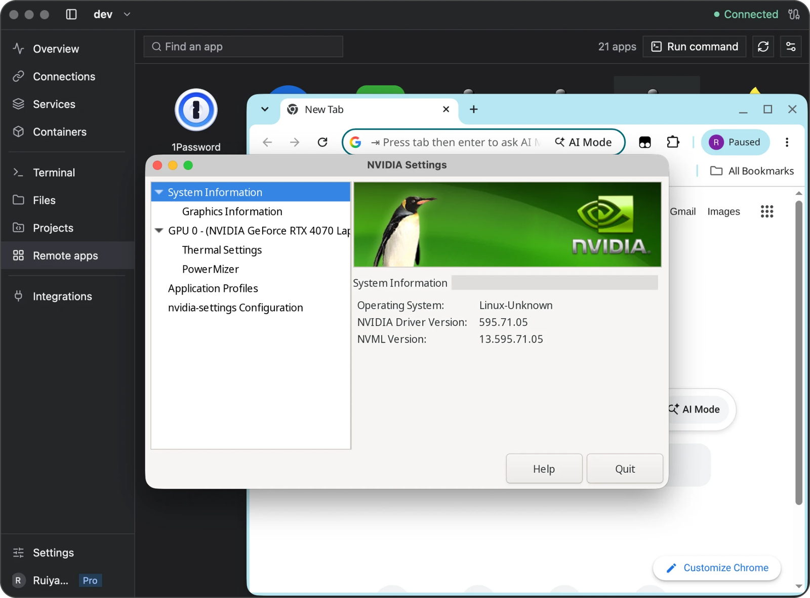

<p align="center">
  
</p>

<h1 align="center">Newport</h1>

<p align="center"><strong>Work on your Linux servers from localhost.</strong></p>

<p align="center">
  Newport is a desktop app for Mac and Windows that connects to your Linux servers over SSH.<br />
  Open your server's web apps on localhost, work in terminals and code, and run Linux apps in their own windows.
</p>

<p align="center">
  <a href="https://newport.app/#download"><strong>Download</strong></a> ·
  <a href="docs/README.md">User guide</a> ·
  <a href="https://newport.app/releases">What's new</a> ·
  <a href="https://github.com/ruiyangke/newport/issues">Report an issue</a>
</p>


## Everything for your server, in one window

Add a server once. Newport gives it its own workspace, and everything below is
one click away.

**Port forwarding.** Newport finds the ports your server listens on. Turn one
on and it opens on localhost. It reconnects by itself and keeps running when
you close the window. [Connections](docs/connections.md)

**Terminals.** Open as many tabs as you need, name them and search their
output. vim, htop and tmux work as they should, mouse and emoji included.
[Terminals](docs/terminal.md)

**Code and Git.** Clone from a URL, start a new repository or open an existing
one. Edit on the server with completion, errors and formatting from your
language servers. Review, commit, pull and push without leaving the window.
[Projects and Git](docs/projects.md)

**Files.** Browse your server, preview code, images and PDFs, and upload or
download with progress. [Files](docs/files.md)

**Monitoring.** See CPU, memory, load, network, disk and processes, live and up
to seven days back. [Monitoring](docs/monitoring.md)

**Services.** Find systemd services, follow their logs, and start, stop or
restart them. [Services](docs/services.md)

**Containers.** Docker and Podman containers and Compose projects: logs,
shells, restarts, and their ports on localhost. [Containers](docs/containers.md)

**Clipboard and browser.** Copy on your computer and paste on the server. Links
from the server open in your browser, so sign-ins like `wrangler login` just
work. Off until you turn them on. [Clipboard and browser](docs/clipboard.md)

**Linux apps.** Run apps like Chrome, DBeaver and GIMP on your server, each in
its own window on your Mac, with copy and paste in both directions. Part of
Newport Pro, with a free trial; macOS only for now. [Remote apps](docs/terminal-gui.md)



## Download

| Your computer | Download |
| --- | --- |
| Mac with Apple silicon, macOS 14 or later | [Newport for Mac](https://newport.app/downloads/latest/macos-arm64) |
| Windows (x64) | [Installer](https://newport.app/downloads/latest/windows-x86_64) |
| Windows (ARM64) | [Installer](https://newport.app/downloads/latest/windows-aarch64) |

Newport keeps itself up to date; you choose when to restart. The Windows
versions are experimental and not code-signed yet.

Start with [Getting started](docs/getting-started.md): add your first server in
a minute, or import the hosts you already have in `~/.ssh/config`.

## What your server needs

Linux on x86_64 or ARM64, and SSH. That's enough for terminals and port
forwarding; Files uses SFTP. For monitoring, port discovery, projects, services
and containers, Newport offers to install Needle, its small helper, the first
time you connect. Servers reached through `ProxyJump` or `ProxyCommand` aren't
supported yet. [Requirements](docs/getting-started.md)

## Help

- [User guide](docs/README.md)
- [Troubleshooting](docs/troubleshooting.md)
- [Security and privacy](docs/security.md)
- [Roadmap](docs/roadmap.md)
- [Issues and feature requests](https://github.com/ruiyangke/newport/issues)

When you report a bug, include your app and OS versions, the steps that cause
it, and logs with passwords and other private details removed.

## Build from source

Newport is free and open source, written in Rust with GPUI. Everything goes
through `cargo xtask`; to run the app:

```sh
cargo xtask dev
```

The [xtask guide](tools/xtask/README.md) lists every command, the
[testing guide](tools/xtask/testing.md) covers local and remote checks, and
[CONTRIBUTING.md](CONTRIBUTING.md) explains how to change code and commit.

## License

[MIT](LICENSE) © 2026 Ruiyang Ke (ruiyangke).
