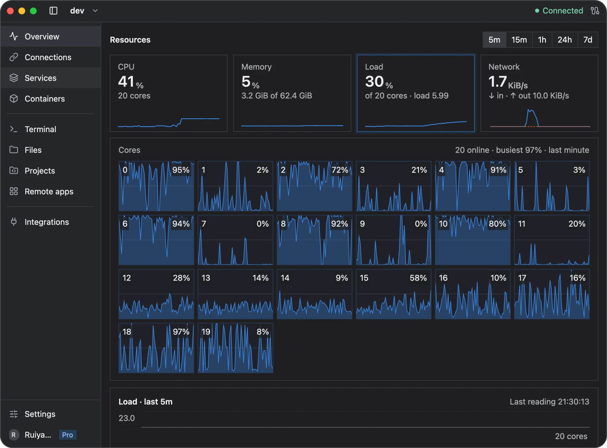

# Newport user guide

Newport puts your Linux servers in one window on macOS or Windows. Connect over SSH to use terminals, forward ports, browse files, edit projects, and manage services and containers. Terminals are uninterruptible: your shells keep running on the server after you quit Newport or lose the connection.

Start with [Getting started](getting-started.md) to install Newport and connect your first server.

The screenshots show Newport on macOS. Windows uses the same page names, and the guides list its keyboard shortcuts where they differ. Your server names and values will differ.

## Work with your server

| I want to… | Guide |
| --- | --- |
| Open a server's web app on my computer | [Connections and port forwarding](connections.md) |
| Run commands on the server | [Terminals](terminal.md) |
| Keep shells running after I quit or disconnect, like tmux | [Terminals](terminal.md#uninterruptible-terminals) |
| Browse, preview, upload, or download files | [Remote files](files.md) |
| Edit code, review changes, and use Git | [Projects and Git](projects.md) |
| Get completion, diagnostics, and refactoring tools | [Language tools](language-servers.md) |
| See resource usage and history | [Server monitoring](monitoring.md) |
| Inspect systemd services and their logs | [Services](services.md) |
| Manage Docker containers and Compose projects | [Containers and Compose](containers.md) |
| Paste from my clipboard on the server, or open server links in my browser | [Clipboard and browser sharing](clipboard.md) |
| Run Linux apps in windows on my computer | [Remote apps](remote-apps.md) |

## Manage Newport

- [Account and Pro](account.md): sign in, start a trial, and use Newport Pro on your computers.
- [Settings](settings.md): theme, startup, keyboard shortcuts and app settings.
- [Updates and installation](updates.md): check your version, update, and fix installation problems.
- [Storage and recovery](storage.md): what Newport saves, clearing history, and backups.
- [Security and privacy](security.md): SSH trust, permissions, clipboard access, and known limits.
- [Troubleshooting](troubleshooting.md): find a fix or report a problem.

Select a server before you open a page. Connection settings and sharing permissions belong to that server. Closing Newport's window keeps its connections, such as forwards, running; quitting Newport disconnects them.
