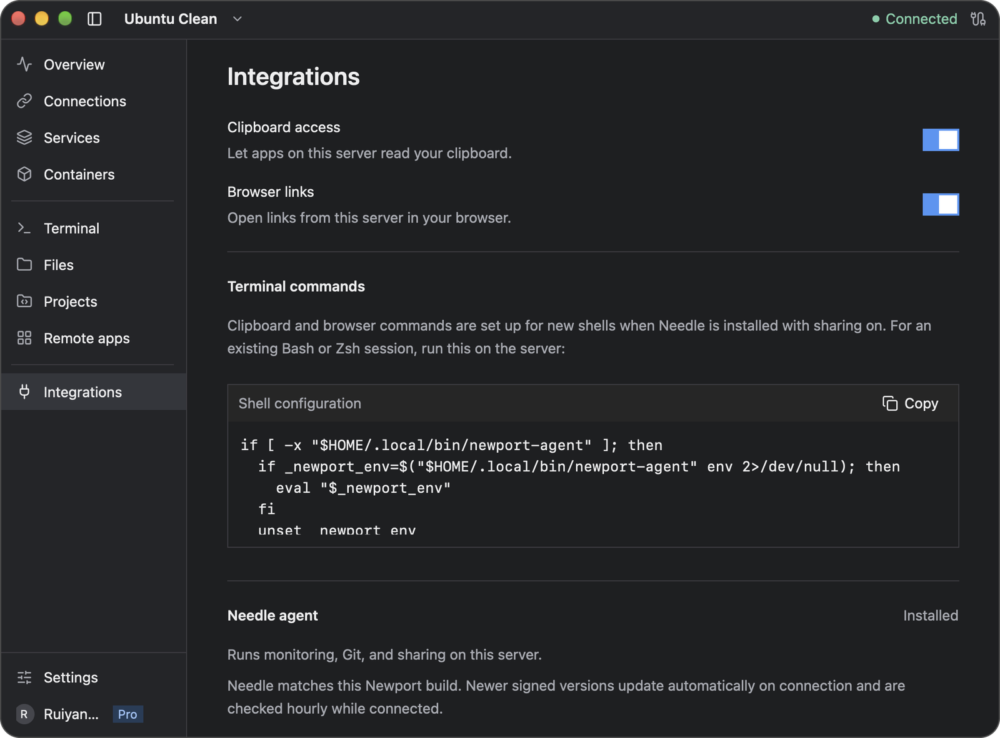

# Clipboard and browser sharing

Let programs on your server paste what you copied on your computer, and open links in your computer's browser. Copying from the server to your computer works without any setting. Newport must be running and connected for sharing to work.

The commands in this guide run on the server, in a Newport terminal unless a section says otherwise.

## What needs permission

- **Clipboard access** lets programs on the server read your computer's clipboard.
- **Browser links** lets programs on the server open links in your computer's browser.
- Text copied on the server, in a terminal or a Linux app, reaches your computer's clipboard without either setting.

## Turn sharing on

1. Select the server and open **Integrations**.
2. Turn on **Clipboard access**, **Browser links**, or both. If **Apply permissions** appears, choose it.

Each switch is saved for that server. Both are on in the setup step until you turn them off, and off for a server saved any other way. Turning one off stops sharing at once. Changing how Newport connects to the server turns both off; see [Change or delete a saved server](storage.md#change-or-delete-a-saved-server).

Turn on **Clipboard access** only for a server you trust. Any program running under your account there can then read what you copy, including passwords.



## Paste into a program on the server

To paste text into a terminal, press **Cmd+V** on macOS or **Ctrl+Shift+V** on Windows. This works without **Clipboard access**.

With **Clipboard access** on, programs on the server can read your clipboard themselves, including images. Use the program's own paste action, for example to attach an image in a coding assistant.

Clipboard commands such as `xclip`, `xsel` and `wl-paste` work in Newport terminals. Install the ones you need from the server's packages. For example, in a Newport terminal:

```sh
# Print the text you copied on your computer.
xclip -selection clipboard -o

# Save an image you copied as image.png in the current folder.
xclip -selection clipboard -o -t image/png > image.png
```

The second command replaces any `image.png` already there. Plain `xclip -o`, `xsel -o` and `wl-paste --primary` read your clipboard too.

Without a clipboard command, use `newport-agent clipboard`. `-t TARGETS` lists the formats on offer:

```sh
~/.local/bin/newport-agent clipboard -o
~/.local/bin/newport-agent clipboard -o -t image/png > image.png
```

### Claude Code and OpenCode

Turn on **Clipboard access**, then start the tool in a Newport terminal and use its own image-paste action.

OpenCode v1 reads images with `wl-paste` or `xclip` and text with `xsel`, so install those. OpenCode v2 needs `libxcb.so.1` or `libwayland-client.so.0` on the server.

## Copy from the server to your computer

- Select text in a terminal and press **Cmd+C** on macOS or **Ctrl+Shift+C** on Windows. Hold **Shift** while you select if a program is using the mouse.
- Programs that copy through the terminal, such as tmux and many editors, put text on your clipboard, up to 8 MiB.
- Copying with `xclip -selection clipboard`, `xsel --clipboard --input` or `wl-copy` in a Newport terminal puts the text on your clipboard. Only text is sent, and only from the clipboard: `xclip` without `-selection clipboard` stays on the server.
- With [Remote apps](remote-apps.md), what you copy in a Linux app can be pasted on your computer.

None of these can read or clear your clipboard. They don't need **Clipboard access**.

## Open links in your browser

With **Browser links** on, run:

```sh
newport-agent open https://example.com
```

`xdg-open` and programs that use the `BROWSER` variable open links the same way. If the server has its own graphical desktop, `xdg-open` may use that desktop instead; use `newport-agent open` to open the link on your computer.

Only `http` and `https` links open, and not ones with a username or password in them.

When a command on the server signs you in through your browser, Newport forwards its `http://localhost` sign-in callback for you. If the browser opens but the sign-in never finishes, use the tool's manual or device-code sign-in instead.

## Which computer is used

A server's shells are shared by every computer that has them open. A Newport terminal's clipboard reads, copies and links go to the computer where you last typed, pasted or clicked in it. See [Use a server's shells from several computers](terminal.md#use-a-servers-shells-from-several-computers).

A terminal opened on a computer with [Remote apps](remote-apps.md) set up for the server, and a trial or Pro, uses the clipboard of the computer showing the server's Linux apps. The shell keeps this for as long as it runs, even when you use it on another computer.

Linux apps can replace that computer's clipboard at any time, even while you work in another app. With **Clipboard access** off, programs on the server can still read what those Linux apps copied, but not what you copied on your computer.

In a shell Newport didn't open, such as a plain `ssh` login, `newport-agent clipboard` and `newport-agent open` use the computer connected to the server. If several are connected, they ask you to run the command in a Newport terminal on the one you want.

## Use a shell Newport didn't open

Newport terminals are set up for sharing. New shells that start some other way pick up the setup from your shell's startup files. To set up a Bash or Zsh shell that was already running, copy the command from **Terminal commands** in **Integrations** and run it there. In Fish, run:

```fish
~/.local/bin/newport-agent env --shell fish | source
```

Then restart the programs that were already running in that shell.

To give one program outside a Newport terminal its own clipboard connection, run it with `newport-agent display`, choosing `x11` or `wayland` to suit the program:

```sh
newport-agent display --backend wayland -- COMMAND
```

Replace `COMMAND` with the program and its arguments.

## Troubleshooting

| Symptom | Fix |
| --- | --- |
| A program reads the clipboard of the wrong computer | Type in the terminal on the computer you want, then try again. |
| A clipboard command says it can't open the display | Run it in a Newport terminal, or use `newport-agent clipboard -o`. |
| A clipboard read fails and names a computer | Turn on **Clipboard access** for the server in **Integrations** on that computer. |
| A link doesn't open and names a computer | Turn on **Browser links** for the server in **Integrations** on that computer. |
| The browser owner reports an incompatible protocol | Update Needle from Newport and reconnect to the server. |
| The browser opening result could not be confirmed | Check whether the link opened before trying again. |
| "Several computers are connected to this server." | Run the command in a Newport terminal on the computer you want. |
| "Open this terminal in Newport to continue." | No computer has the shell open. Open its tab and try again. |
| "Show this server's apps in Newport to continue." | The terminal is set up for [Remote apps](remote-apps.md), and no computer shows the server's apps. Choose **Show here** in **Remote apps**, or type in one of the server's terminals. |
| Text pastes, but an image doesn't attach | Use the program's own image-paste action, and check the libraries it needs. |
| Commands fail in a shell that was running before | Run the setup command from **Integrations**, then restart the program. |
| A program left running after its terminal closed, such as tmux in a project editor terminal, can't reach the clipboard | Use `newport-agent clipboard -o`, or start the program in a Newport terminal. |
| A link opens on the server's own desktop | Use `newport-agent open URL`. |
| Sharing stopped after a disconnect | Check the connection and the switches in **Integrations**, then try again. |

Files you or a program save from the clipboard are ordinary files on the server; turning sharing off doesn't delete them. See [Security and privacy](security.md).

[Back to the user guide](README.md)
