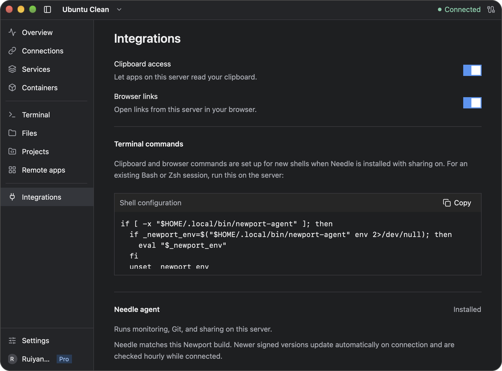

# Clipboard and browser sharing

Share text and images from your computer with remote tools, or let a command on the server open a link in your local browser. Newport must remain running and connected for these features to work.

## Turn sharing on

1. Select the server and open **Integrations**.
2. Install Needle, Newport's helper on the server, if prompted.
3. Enable **Clipboard access** or **Browser links**. If **Apply permissions** appears, choose it to finish.
4. Open a new Newport terminal so remote tools use the updated environment.

The two permissions are independent and saved for each server. Turning one off stops pending requests for that feature. Changing a server's host, SSH port, or username clears both permissions for the new destination.

**Enable Clipboard only for servers you trust.** Programs running under your remote account can request what you copy, including passwords and other sensitive content. Browser sharing lets those programs request tabs on your computer.



Both sharing switches are enabled in this example. Yours start off; enable only the permissions you want to grant to the selected server. Scroll below the shell setup in Integrations to check Needle's installation status.

## Paste into a remote tool

Use Newport's terminal paste shortcut to paste text: **Cmd+V** on macOS or **Ctrl+Shift+V** on Windows.

For an image attachment, copy an image on your computer and use the remote application's own image-paste action. That application reads the shared clipboard. Pasting text into the terminal and attaching an image inside an application are separate actions.

Needle supplies compatible `xclip`, `xsel`, and `wl-paste` commands for tools that use them. You do not need to install the system clipboard-command packages just to use these helpers. For example, run these commands on the server:

```sh
# Read the text currently copied on your computer.
xclip -selection clipboard -o

# Save a copied PNG image in the current remote directory.
xclip -selection clipboard -o -t image/png > image.png
```

The second command creates or replaces `image.png`. If another clipboard command already takes precedence on your server, use Needle directly:

```sh
~/.local/bin/newport-agent clipboard -o
```

### Claude Code and OpenCode

Enable Clipboard, then start the tool in a new Newport terminal. For the application-specific action, use the official guide for your version:

- [Claude Code keyboard controls](https://code.claude.com/docs/en/interactive-mode#general-controls) document pasting an image into its prompt.
- [OpenCode v1 keybindings](https://opencode.ai/docs/keybinds/) document the configurable `input_paste` action.
- [OpenCode v2 keybindings](https://opencode.ai/v2/docs/cli/keybinds) document `prompt.paste`; its [attachments guide](https://opencode.ai/v2/docs/attachments) describes supported image formats and model requirements.

Use those actions inside the remote tool after copying an image on your computer. They are separate from Newport's terminal text-paste shortcut.

OpenCode v1 uses Needle's clipboard commands. OpenCode v2 reads the private X11 or Wayland clipboard display and also needs the matching client library on the server: `libxcb.so.1` for X11 or `libwayland-client.so.0` for Wayland. Keep the environment set by Newport when launching it. Missing-library errors need to be resolved on the server.

## Copy text back to your computer

Select terminal text and copy it with **Cmd+C** on macOS or **Ctrl+Shift+C** on Windows. Hold **Shift** while selecting if a terminal application is handling the mouse.

Remote programs can also copy plain text through the terminal's OSC 52 support. This is used by tools such as tmux and editors configured for OSC 52. Newport accepts text writes up to 8 MiB; terminal escape sequences cannot read or clear your local clipboard.

The Clipboard switch controls remote access to your computer's clipboard. Copying text from a terminal is a separate operation.

## Open links in your browser

With Browser enabled, run:

```sh
newport-agent open https://example.com
```

In a headless session, `xdg-open https://example.com` also uses Newport. On a server with its own graphical desktop, the alias can delegate to that desktop instead. Tools that honor the `BROWSER` environment variable use the browser command supplied by Needle.

Only HTTP and HTTPS links without embedded usernames or passwords are accepted.

Some browser sign-ins redirect back to a command on the server. Newport temporarily forwards an explicit HTTP loopback callback in the login URL. Device-code logins do not need a callback. If a browser opens but login never finishes, follow the tool's manual login instructions; hidden callback ports, HTTPS callbacks, and listeners inside containers may need separate forwarding.

## Use an existing shell or tmux session

New Newport terminals receive Needle's environment automatically. Needle also adds managed shell setup for new shells when sharing is installed. To refresh an existing Bash or Zsh shell, run:

```sh
if [ -x "$HOME/.local/bin/newport-agent" ]; then
  if _newport_env=$("$HOME/.local/bin/newport-agent" env 2>/dev/null); then
    eval "$_newport_env"
  fi
  unset _newport_env
fi
```

For Fish, apply its setup with:

```fish
~/.local/bin/newport-agent env --shell fish | source
```

Restart applications already running in the old shell after refreshing its environment.

If several Newport computers are connected to this remote account, run `newport-agent sessions` and find the session for the computer you want. Copy its session ID, then select it in the remote shell before refreshing the environment:

```sh
export NEWPORT_SESSION='PASTE_SESSION_ID_HERE'
```

In Fish, use `set -gx NEWPORT_SESSION 'PASTE_SESSION_ID_HERE'` instead. The chosen session still needs the appropriate sharing permission in Newport. Open a new Newport terminal for the simplest way to get its own session environment.

Needle preserves an existing graphical desktop environment. Applications that read X11 or Wayland directly may need a private clipboard display. You can run one explicitly:

```sh
newport-agent display --backend x11 -- COMMAND
newport-agent display --backend wayland -- COMMAND
```

Replace `COMMAND` with the program to run and choose its supported backend. These commands provide a clipboard display; to run a graphical application, see [Remote apps](terminal-gui.md).

## Reconnection and troubleshooting

| Problem | What to try |
| --- | --- |
| A tool cannot find `xclip`, `xsel`, or `wl-paste` | Update Needle in **Integrations**, turn Clipboard off and on, and open a new terminal |
| Text pastes, but an image does not attach | Use the application's image-paste action and check its clipboard library requirements |
| An old terminal cannot find its session | Refresh its environment, then restart the affected application |
| Several computers are connected | Run `newport-agent sessions` and check which session has the intended permission; Newport will not silently choose an ambiguous destination |
| A link opens on the server's desktop | Use `newport-agent open URL` to explicitly request your computer's browser |
| Sharing stopped after a disconnect | Check the connection and permissions in **Integrations**, then retry the application's action |

Clipboard data requested through sharing is cached in memory until it changes or sharing disconnects. Files that you or a remote application save from the clipboard are ordinary remote files; disabling sharing does not delete them.

Use **Integrations** to install, update, or uninstall Needle. Uninstalling stops its remote services and removes Newport-managed helper files and shell setup. Turning sharing off leaves Needle available for other features such as monitoring and Git.

[Back to the user guide](README.md)
