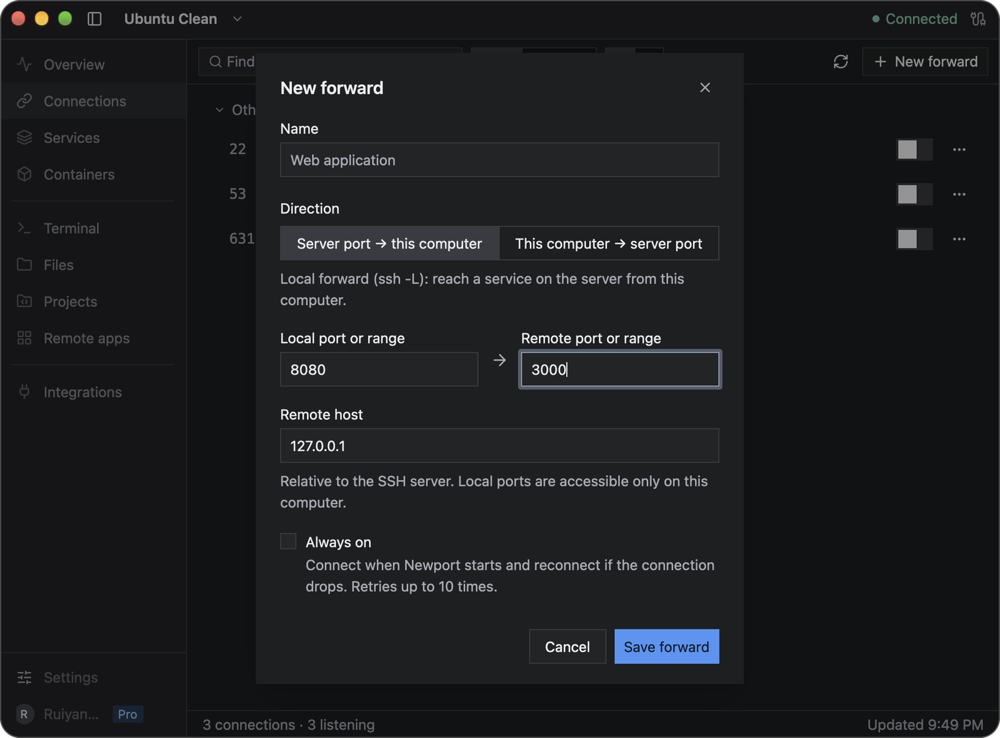

# Connections and port forwarding

Use **Connections** to open a web app running on your server in your computer's browser, or to let the server reach a service on your computer. Newport carries the traffic over your SSH connection.

In this guide, **your computer** is the one running Newport and **the server** is the one selected in Newport. `localhost` and `127.0.0.1` mean the machine where you use the address: your computer in its browser, or the server in a Newport terminal.

## Open a server's web app

1. Start the app on the server, for example a development server on port `3000`.
2. Select the server in Newport and open **Connections**. It lists the ports listening on the server, grouped by project where it can.
3. Turn on the switch beside the port.
4. Open the local address shown for the port in your browser, such as `http://localhost:3000`.

Newport uses the same port number on your computer unless another forward already uses it. Then it picks another, so use the address Newport shows.

## Find a port

Two buttons in the toolbar switch the view:

- **Projects view** groups ports and forwards by project, with a group for each worktree. Use it to see what each project runs and to forward a whole project.
- **Ports view** lists every port in one table. Choose a column heading to sort.

**Show** narrows the list to **All**, **Saved** forwards, including those switched off, or **Needs attention**. Type in **Find a connection** to search the list, and choose **Refresh** to read the server's ports again.

Services that don't belong to a project appear under **System services**. A port Newport can't link to a process appears under **Other services** as **TCP listener**; it may still be in use. Ports that Docker or Podman publish are labeled separately.

A row that says **Last observed** comes from an earlier scan. **Destination not observed** on a saved forward means the current scan didn't see its port; the forward still works and can be edited.

## See what a port runs

Choose a connection's name, or hold the pointer over its row, to see the addresses it listens on, the account and processes that own it, and its service. With the keyboard, Tab to the name, press Enter or Space to open the details, and Escape to close them.

A service listening on several addresses shows as one row:

- If it listens on both `127.0.0.1` and `::1`, forwarding uses `127.0.0.1`.
- If it listens on all addresses, `0.0.0.0` or `::`, Newport reaches it at the server's own address, `127.0.0.1` or `::1`.
- If its addresses differ in other ways, **Choose server address** asks which one to use. To change it later, choose **Forward with options…** from the row's menu and edit **Remote host**.

## Discovery details

Choose **Discovery details** in the toolbar to see which parts of the last scan completed and what limited it, such as permissions or scan limits. When Newport can't tell which process owns a port, the port stays outside project groups and the reason shows here. A **Failed scan** can't confirm that a saved forward is unused.

## Forward a whole project

In **Projects view**, a project with more than one port has **Forward project** in its heading. It turns on the project's saved forwards and forwards each listening port that has none. **Stop project** turns them off.

A worktree with more than one port has **Forward worktree** or **Stop worktree** for that worktree alone. These buttons don't stop forwards from your computer to the server.

If a port needs an address choice, forward that row individually first, then retry the group action. Saved forwards can still be stopped when discovery is unavailable.

## Create a forward by hand

Choose **New forward** to forward a port that isn't listed, to pick the local port, or to let the server reach your computer.

- **Name**: a name for the forward.
- **Direction**: **Server port → this computer** opens a server port on your computer. **This computer → server port** opens a port on the server that leads to your computer.
- **Local port or range** and **Remote port or range**: the port on your computer and the port on the server.
- **Remote host**: where the server finds the service, for **Server port → this computer**. Usually `127.0.0.1`, the server itself.
- **Listen address on the server**: which address the server opens the port on, for **This computer → server port**.

Choose **Save forward**. Then turn on its switch in **Connections**. A range must have the same length on both sides. If the server has projects, you can also choose a **Project** to list the forward under.

### Example: open a server app on your computer

The app listens on port `3000` on the server. Create a forward with:

- **Direction:** **Server port → this computer**
- **Local port or range:** `8080`
- **Remote port or range:** `3000`
- **Remote host:** `127.0.0.1`

Turn it on and open `http://localhost:8080` in your computer's browser. `127.0.0.1` here means the server itself.

### Example: let the server reach an app on your computer

The app listens on port `3000` on your computer. Create a forward with:

- **Direction:** **This computer → server port**
- **Local port or range:** `3000`
- **Remote port or range:** `8080`
- **Listen address on the server:** `127.0.0.1`

Turn it on, then run `curl http://127.0.0.1:8080` in a Newport terminal. The reply comes from the app on your computer.

Keep the listen address at `127.0.0.1` so only the server itself can connect. Any other address needs `GatewayPorts` in the server's SSH configuration and can let other machines reach the service on your computer.

## Keep a forward running

Turn on **Always on** in a forward's settings to connect it when Newport starts and reconnect it if the connection drops. Newport keeps reconnecting while **Always on** is on. When it needs you to fix something, such as a refused sign-in or a changed host key, it stops and shows the problem.

To change a saved forward, use the **…** (**More actions**) button on its row: **Edit…**, **Always on** and **Delete…**. **Delete…** removes the saved forward. For a port with no saved forward, **…** has **Forward with options…** instead.

Closing Newport's window keeps forwards running. Quitting Newport stops them.

Forwarded ports on your computer accept connections only from your computer, not from other machines on your network.

## Check a forward's status

Each row shows a status:

- **Forwarding**: the forward is on and working.
- **Forwarding off**: the port isn't forwarded, or its forward is switched off.
- **Connecting…**: the forward is starting.
- **Reconnecting…** or **Retrying…**: the connection dropped and Newport is connecting again.
- **Unreachable**: the forward is on but can't reach the app. The row says why, such as `Connection refused`.
- **Failed**: the forward stopped. The row shows the error and **Edit forward** to fix it.

## Clean up forwards

When saved forwards say **Destination not observed**, the broom button **Clean up forwards** appears in the toolbar of **Connections**, beside **Refresh**. It offers every one of them, whether it is on or off, and wherever it leads. Forwards that lead to your computer are never included.

Choose it to see the forwards, then choose **Delete forwards** to remove them, or **Cancel**. Deleting a forward that is on also stops it. Newport checks the list again when you confirm, and asks you to review it if anything changed.

The button appears only while Newport is connected to the server and has a current scan. Discovery itself never deletes or stops a forward.

## Troubleshooting

| Symptom | Fix |
| --- | --- |
| The port isn't listed | Check that the app is running on the server, then choose **New forward** and enter the port. |
| The local port is in use | Choose **New forward** and enter another local port, such as `8081`. |
| The forward is on but the app doesn't load | Check the port and remote host, that the app is listening, and whether it expects `http` or `https`. |
| A forward waits after your SSH agent declined the login | It connects when the server does: after you choose **Test connection** at the top of the window, when you open a terminal, or when your computer wakes, unlocks or changes network. |
| SSH refuses the forward | Ask the server's administrator whether your account may forward ports. |
| A port on the server can't be opened | Another program may be using it, or the server's SSH settings may not allow that listen address. |
| The forward stopped reconnecting | Check that you can connect to the server, then turn the forward on again. |

A forward only carries traffic; it doesn't start the app at either end. For SSH errors, see [Troubleshooting](troubleshooting.md).

[Back to the user guide](README.md)
