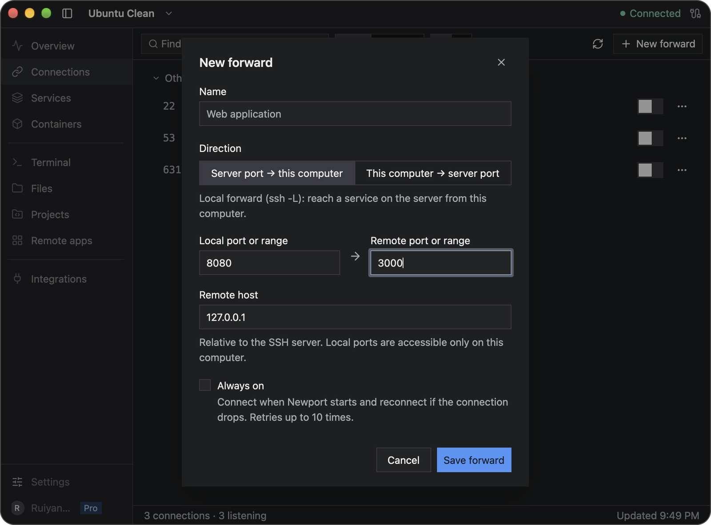

# Connections and port forwarding

Port forwarding lets you reach a service through your SSH connection. A local forward opens a remote service on your computer; a reverse forward lets the server reach a service on your computer.

In this guide, **local** means the computer running Newport and **remote** means the Linux server selected in Newport. `localhost` and `127.0.0.1` mean the machine where you use that address: your computer in its browser, or the server in a Newport terminal.

## Open a remote web app

1. Start the app on the server, such as a development server listening on port `3000`.
2. Select that server in Newport and open **Connections**.
3. Find the port and turn on its **Forward port** switch. Needle discovers listening ports and groups them by project, worktree, or Compose project where possible.
4. Open the displayed local address in your browser.

For example, if remote port `3000` is forwarded to local port `3000`, open `http://localhost:3000`. If Newport uses a different local port, use the address shown in the app.

Port discovery requires Needle. You can still create a forward by number when discovery is unavailable.

## Create a manual forward

Choose **New forward** in Connections, then fill in the form:

| Field | Local forward | Reverse forward |
| --- | --- | --- |
| **Name** | A name for the connection | A name for the connection |
| **Direction** | **Server port → this computer** | **This computer → server port** |
| **Local port or range** | The port to open on your computer | The local service's port |
| **Remote port or range** | The remote service's port | The port to open on the server |
| Host/address field | **Remote host**: the service address as reached from the SSH server | **Listen address on the server**: the address on which the server accepts connections |

Choose **Save forward**, then turn on the saved forward's switch in Connections. If you use port ranges, match their lengths so each local port has a corresponding remote port. You can assign a saved forward to a project when the form offers one.

### Example: open a server app on your computer

Suppose your app is already listening on port `3000` on the Linux server. Create a forward with:

- **Direction:** Server port → this computer
- **Local port or range:** `8080`
- **Remote port or range:** `3000`
- **Remote host:** `127.0.0.1`

Save it, switch it on, and open `http://localhost:8080` in the browser **on your computer**. The remote host is relative to the SSH server, so `127.0.0.1` here reaches the server's own app.

The two port fields correspond to different machines: `8080` on your computer and `3000` on the selected server.

### Example: let the server reach an app on your computer

Suppose an app is already listening on port `3000` on your Mac or Windows computer. Create a forward with:

- **Direction:** This computer → server port
- **Local port or range:** `3000`
- **Remote port or range:** `8080`
- **Listen address on the server:** `127.0.0.1`

Save it, switch it on, then run `curl http://127.0.0.1:8080` in a **Newport terminal on the server**. The response comes from the app on your computer. This example assumes `curl` is installed on the server.

Keep the listen address at `127.0.0.1` to restrict access to the server itself. Other addresses require the SSH server's `GatewayPorts` setting and can make your computer's service reachable by other machines.

## Keep a connection available

Enable **Always on** to connect when Newport starts and retry after a dropped connection. Newport retries up to ten times. If the connection remains down, resolve the problem and start it again.

Closing the main window keeps forwards running. Quitting Newport stops them. Disconnect a forward when you are done; removing a saved forward also removes its saved configuration.

Local forwards listen only on your computer's loopback interface. They do not publish a service to other computers on your network.

## Troubleshooting

| Problem | What to check |
| --- | --- |
| The port is missing from discovery | Confirm that the service is running and Needle is available; use **New forward** if needed |
| The local port is already in use | Choose another local port, such as `8081`, and use it in your browser |
| The forward connects but the app does not load | Check the remote host and port, whether the service is listening, and whether it expects HTTP or HTTPS |
| SSH refuses forwarding | Ask the server administrator whether forwarding is allowed for your account |
| A reverse port is unavailable | Check whether the port is already in use on the server and whether its SSH policy allows the bind address |
| Reconnection stopped | Check the SSH connection, then manually start the forward again |

A forward only carries traffic; it does not start the application at the other end. For general SSH errors, see [Troubleshooting](troubleshooting.md).

[Back to the user guide](README.md)
