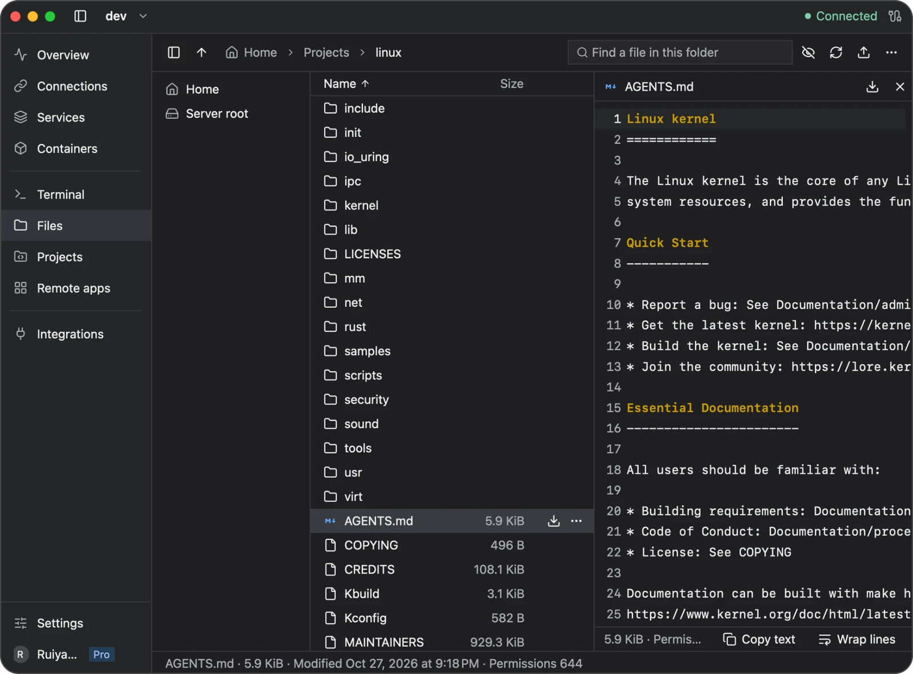

# Remote files

Use **Files** to browse a server, preview a file, or transfer it between the server and your computer. Newport connects with your saved SSH credentials. Your server must support SFTP, and your SSH account must have permission to access the files.

## Find a file

1. Select a server and open **Files**.
2. Open folders in the file list, or choose **Go to folder** from the three-dot menu at the top right and enter a remote path. **Home** returns to your account's initial SFTP directory.
3. Filter by name or show hidden files when needed.
4. Select a file to preview it.

Large folders are split into pages of 40 entries. A listing can contain up to 20,000 entries; open a smaller folder if you reach that limit.

This example previews `AGENTS.md` in a Linux source checkout. The upward arrow at the top right uploads a file; the downward arrows beside a file or in its preview download it. **Wrap lines** keeps long text visible in the preview.

## Preview a file

| File type | Maximum preview size | Available tools |
| --- | --- | --- |
| UTF-8 text and source code | 1 MiB | Text search and syntax highlighting for supported languages |
| PNG, JPEG, GIF, WebP | 16 MiB | Fit and zoom |
| PDF | 16 MiB | Page navigation and text selection |

Newport identifies previews from file content. Encrypted PDFs, unsupported formats, and files over the preview limit can be downloaded instead. Preview content is held in memory rather than saved as a local file.

To edit source files on the server, use the [project editor](projects.md#edit-and-save-files). Its editing limits differ from the preview limits above.

## Upload a file

1. Open the destination folder on the server.
2. Choose the **Upload** button (upward arrow) and select one file on your computer.
3. Wait for the transfer to finish before using the remote file.

Uploads do not overwrite an existing remote file. If the name is already taken, renaming your local file uploads a second file under the new name; it does not replace the original. For text files inside a repository, use the [project editor](projects.md#edit-and-save-files). For other file replacements or whole folders, use your usual SFTP tool or server terminal workflow; Newport uploads one file at a time. Uploaded files do not retain executable permissions; set those on the server if the file needs to run as a program.

## Download a file

1. Select the remote file and choose **Download** (downward arrow).
2. Pick a destination in the system save dialog.
3. Confirm replacement if a local file already uses that name.

Newport replaces the destination only when the download succeeds. A failed or cancelled download leaves an existing destination file intact.

## Track or cancel a transfer

Transfers show progress and can be cancelled. Switching pages or servers leaves a transfer running for its original server. Disconnecting its session, changing or deleting that connection, or quitting Newport stops the associated work.

If a transfer fails, check the connection, available disk space, and the destination folder's permissions, then start it again.

An interrupted upload can leave a temporary file named `.newport-upload-<uuid>` in the remote folder. After confirming that the upload is no longer running, you can remove that specific temporary file from a Newport terminal. First use `ls -la /path/to/folder` to identify its exact name, then run `rm -i -- /path/to/folder/.newport-upload-EXACT-ID`, replacing the path and ID with the file you inspected. The command asks before deletion. Do not use a wildcard or remove other active uploads. Newport normally cleans up these files after cancellation or failure, but cannot always do so after losing the connection.

For connection errors, see [Troubleshooting](troubleshooting.md).

[Back to the user guide](README.md)
