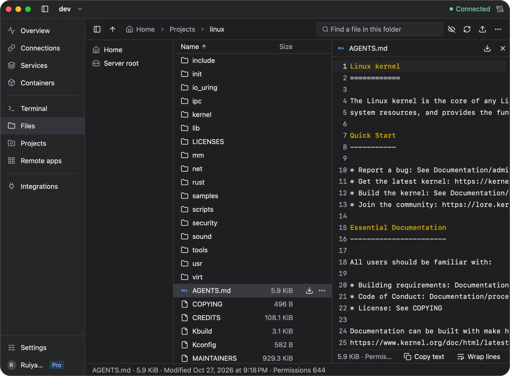

# Remote files

Use **Files** to browse a server's files, preview them, and copy a file between the server and your computer. Newport uses your SSH connection, so you see what your SSH account can read. The server must allow SFTP, which most do.

## Find a file

1. Select a server and open **Files**. It opens in your home folder.
2. Open folders in the list, or click the empty space after the path at the top and type a folder's path. **Go to folder** in the **…** menu (**More folder actions**) does the same.
3. To narrow the list, type in **Find a file in this folder**. The eye button (**Hidden files**) shows or hides hidden files.
4. Select a file to preview it.

**Places**, on the left, has **Home**, **Server root** and your projects on the server. A folder can show up to 20,000 items; for a bigger one, open a folder inside it by path.

## Preview a file

- **Text and source code**: up to the first 1 MiB, with syntax colours, search, **Copy text** and **Wrap lines**.
- **Images**: PNG, JPEG, GIF and WebP up to 16 MiB, with **Fit**, **100%** and zoom.

Newport recognises the type from the file's contents, not its name. Other files, such as PDFs, and images over 16 MiB can be downloaded instead.

To edit files on the server, open the folder as a project with **Open as project**. See [Projects and Git](projects.md#edit-and-save-files).

## Upload a file

1. Open the folder on the server.
2. Choose the upload button (**Upload to this folder**) and pick one file on your computer.
3. Wait for the upload to finish before you use the file.

Newport uploads one file at a time and never replaces a file on the server. If the name is taken, rename your file and upload it again. An uploaded file can be read and changed only by your account; change its permissions on the server if others need it, or if it should run as a program.

## Download a file

1. Choose the download button beside the file or in its preview. You can also choose **Download…** from the file's **…** menu (**More actions**).
2. Pick where to save it. If a file there has the same name, your computer asks before replacing it.

Newport replaces that file only when the download finishes. If the download fails or you cancel it, the file you had stays as it was.

## Track or cancel a transfer

A transfer shows its progress, and you can choose **Cancel**. It keeps running when you switch pages or servers. Quitting Newport, disconnecting the server, or changing or deleting the server stops it.

If a transfer fails, check the connection, the free space on the destination, and that you may write to the folder. Then start it again.

An upload that was cut off can leave a hidden file named `.newport-upload-` followed by an ID in the folder. Newport removes it the next time it reaches the server. If one stays, you can delete it once no upload is running.

For connection problems, see [Troubleshooting](troubleshooting.md).

[Back to the user guide](README.md)
