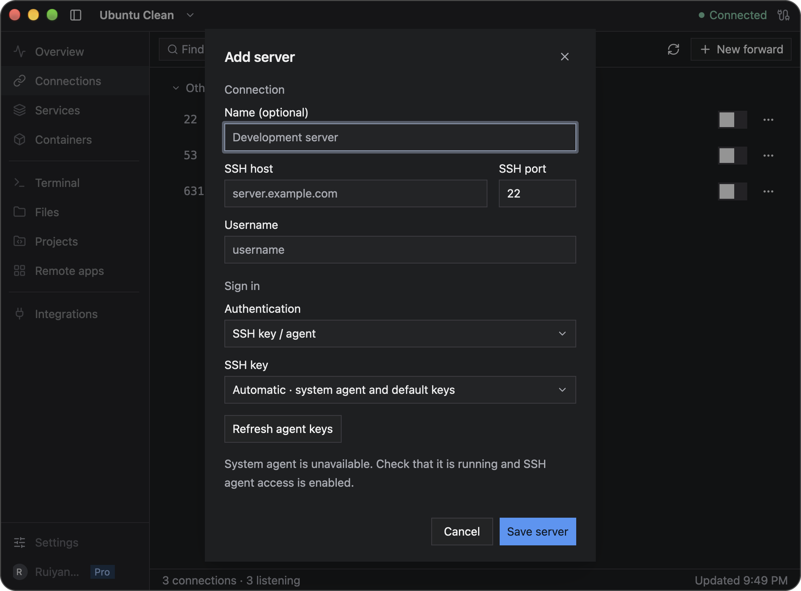

# Getting started

Newport connects your Mac or Windows computer to Linux servers over SSH. From one window you can use shells that keep running on the server, open the server's web apps on your computer, transfer files, and work on projects.

## Before you start

- A Mac with Apple silicon and macOS 14 or later, or a Windows computer with an x64 or ARM64 processor.
- A Linux server with an x86_64 or ARM64 processor that you can reach over SSH. You need its address, your username, and its SSH port (usually `22`).
- An SSH key in your SSH agent or in a key file, or the account's password.

Some pages need more on the server:

- **Files**: SFTP for your SSH account.
- **Projects**: Git, for Git actions.
- **Services**: systemd.
- **Containers**: Docker or Podman; Compose actions also need Compose.
- **Remote apps**: a free trial or Newport Pro. Setup checks the rest.

Servers you reach through a jump host (`ProxyJump`) or a proxy command (`ProxyCommand`) work too.

## Install Newport

Download Newport for your computer from [newport.app](https://newport.app/#download). On a Mac, open the ZIP and move Newport to Applications. On Windows, run the installer for your processor. See [Updates and installation](updates.md) for details.

## Add your first server

If you have hosts in `~/.ssh/config`, the welcome screen shows **Import from your SSH config**. Select the hosts you want and choose the import button, such as **Import 2 servers**. A host that can't be imported shows why under its name.

To enter a server yourself:

1. Choose **Add server**, or **Add server manually** on the welcome screen. Later, open the server picker at the top left and choose **Add server…**.
2. Enter the **SSH host**, **SSH port** and **Username**. **Name (optional)** is the name Newport shows. When you move out of **SSH host**, Newport checks your SSH config for that host and fills in what it sets, such as the username, port, key file or proxy command, in fields you haven't typed in. A line under **SSH host** says what was filled in.
3. Under **Connect through**, keep **Direct**, or choose **Jump host** and pick one of your servers, or **Proxy command** and enter the command. In the command, `%h` is the host, `%p` the port and `%r` the username.
4. Choose **SSH key / agent** or **Password**.
5. For a key, pick it from the **SSH key** menu, or choose **Enter a key-file path…** and enter the path to a private key, such as `~/.ssh/id_ed25519`. A `.pub` file is a public key and can't sign you in. If your key has a passphrase, see [Prepare your SSH key](#prepare-your-ssh-key).
6. Choose **Save server**.

Newport connects to the server. If that fails, choose **Edit connection** to fix the details, or **Try again** after fixing a network problem. If your SSH config sets a different proxy command for the host, choose **Use this command** to save it and try again. Newport trusts a server's host key the first time it connects and stops if the key changes later. See [SSH trust](security.md#trusting-an-ssh-server).



This example shows the message for an SSH agent that isn't available. If you see it, start or unlock your agent as described below.

## Prepare your SSH key

An SSH agent is a program on your computer that signs you in with your keys. A key with a passphrase must be added to an agent before Newport can use it. The server must already accept the key for your account; ask its administrator if it doesn't.

On a Mac, open the **Terminal** app and run these commands, changing the path if your key has another name:

```sh
ssh-add ~/.ssh/id_ed25519
ssh-add -l
```

Enter the passphrase when asked. The second command lists the key. In Newport, choose **Refresh agent keys**, then pick the key marked **System agent** in **SSH key**. You can also choose **Automatic · system agent and default keys** to let Newport try them all.

On Windows, the **OpenSSH Authentication Agent** service must be running. If it is disabled, an administrator can turn it on in PowerShell:

```powershell
Get-Service ssh-agent | Set-Service -StartupType Automatic
Start-Service ssh-agent
```

Then, in PowerShell as your usual user, add and list the key:

```powershell
ssh-add "$env:USERPROFILE\.ssh\id_ed25519"
ssh-add -l
```

Choose **Refresh agent keys** in Newport and pick the key in **SSH key**. If these commands aren't available, follow Microsoft's [OpenSSH key management guide](https://learn.microsoft.com/en-us/windows-server/administration/openssh/openssh_keymanagement).

If your key is in **1Password**, set up its [SSH agent](https://www.1password.dev/ssh/get-started), unlock 1Password and approve its request. On a Mac, pick the key marked **1Password** in **SSH key**. On Windows, 1Password provides keys through the OpenSSH agent, so choose **Refresh agent keys** and pick the key; don't also start the OpenSSH agent service.

## Set up the helper

After the first connection, Newport offers to install its helper, Needle, on the server. When it asks **Install the helper?**, choose **Allow**. Newport copies Needle over SSH and installs it under your account, so you don't need administrator rights.

Next, **Open server links in your browser** and **Share your clipboard with this server** are both on. Turn off any you don't want, then choose **Save and finish**. Share your clipboard only with a server you trust. You can change both later in **Integrations**; see [Clipboard and browser sharing](clipboard.md).

If you chose **Skip**, open **Integrations** and choose **Set up Needle**.

## Find your way around

The server name at the top left switches servers, and the connection status at the top right belongs to that server. The sidebar opens the server's pages; **Settings** and your account are at the bottom. To show or hide the page names, choose the sidebar button beside the server name.


To check your first connection, open **Terminal** and run this command. It runs on the server and prints the server's name:

```sh
hostname
```

Your shells keep running on the server when you quit Newport or lose the connection. See [Terminal](terminal.md).

## Choose what to do next

- [**Overview**](monitoring.md): see the server's resource usage and history.
- [**Connections**](connections.md): open a server's web app on your computer.
- [**Terminal**](terminal.md): run commands in shells that keep running.
- [**Files**](files.md): browse, preview, upload, or download files.
- [**Projects**](projects.md): edit a repository on the server and review Git changes.
- [**Services**](services.md): inspect systemd services and their logs.
- [**Containers**](containers.md): manage Docker containers and Compose projects.
- [**Integrations**](clipboard.md): share your clipboard and browser with the server.
- [**Remote apps**](remote-apps.md): run Linux apps in windows on your computer.

## Quit Newport

Closing the window keeps Newport's connections running. Reopen it from the menu bar or the system tray. To disconnect and exit, choose **Quit Newport**.

When you quit, your server's shells keep running, but terminals in the project editor end. Save your work in the project editor and let file transfers finish first. [Remote apps](remote-apps.md#keep-apps-running) describes what happens to Linux apps.

For connection problems, see [Troubleshooting](troubleshooting.md).

[Back to the user guide](README.md)
