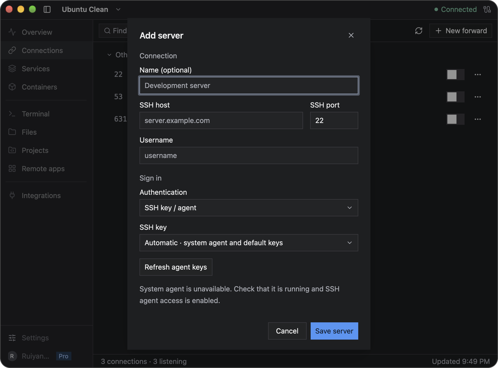
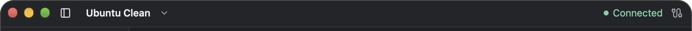

# Getting started

Newport connects your macOS or Windows computer to Linux servers over SSH. You can use a shell, open remote web apps locally, transfer files, and manage projects from the same window.

## Before you start

You need:

- A supported computer: macOS 14 or later on Apple silicon, or Windows on x64 or ARM64. Windows support is experimental; a minimum supported Windows version has not yet been established.
- A Linux server reachable directly over SSH, with its host address, username, and SSH port (usually `22`).
- An SSH key available through your local SSH agent or key file, or the account's password.

Needle, Newport's helper, supports Linux servers with x86_64 or ARM64 processors. Newport offers to install it after connecting. Requirements vary by feature:

| Feature | Requirements |
| --- | --- |
| Terminal and manual forwards | SSH access |
| Files | SFTP enabled for your SSH account |
| Overview, port discovery, Projects and Git | Needle; Git operations also need Git |
| Services | Needle and systemd, Linux's service manager |
| Containers | Needle and Docker; Compose actions also need Docker Compose |
| Remote apps | macOS desktop on Apple silicon; Needle, graphical dependencies checked during setup, and trial or Pro access |

Servers reached through a jump host (`ProxyJump`) or a helper program (`ProxyCommand`) work too. Newport imports both settings from your `~/.ssh/config`.

## Install Newport

Download the package for your computer from [newport.app](https://newport.app/#download). On macOS, extract the ZIP and move Newport to Applications. On Windows, run the installer that matches your processor.

See [Updates and installation](releases.md) for download links and platform details.

## Add your first server

If you already have hosts in `~/.ssh/config`, the welcome screen offers **Import from your SSH config**. Select the hosts you want and choose **Import**. Hosts with unsupported connection settings cannot be selected.

To enter a server yourself:

1. Choose **Add server** or **Add server manually**. Later, open the server-name picker and choose **Add server…**, or use **Server → Add server…**.
2. Enter the **SSH host**, **SSH port**, and **Username**. Give the connection an optional name you will recognize.
3. Under **Connect through**, keep **Direct**, or choose **Jump host** and pick one of your servers to sign in through, or **Proxy command** and enter the command, as in ssh's `ProxyCommand`. In the command, `%h` is the host, `%p` the port and `%r` the username.
4. Choose **SSH key / agent** or **Password** under Authentication.
5. For key authentication, select a key from the **SSH key** menu, or choose **Enter a key-file path…** and provide the path to a private key on your computer, such as `~/.ssh/id_ed25519`. A `.pub` file is the public half of a key and cannot authenticate by itself. For a protected key, follow [Prepare your SSH key](#prepare-your-ssh-key) below, then choose **Refresh agent keys**.
6. Choose **Save server**.

Newport checks the connection. If it fails, use **Edit connection** to correct the details or **Try again** after resolving a network issue. Host keys are trusted on first use; a changed or revoked key stops the connection. See [SSH trust](security.md#trusting-an-ssh-server).



The example shows the agent-unavailable message. If you see it too, start or unlock your agent and follow the steps below; the fields above it are where you enter your own server details.

## Prepare your SSH key

An SSH agent is a program on **your computer** that uses your keys for authentication. A passphrase-protected key must be loaded into an agent before Newport can use it. The matching public key must already be authorized for your account on the server; ask the server administrator if you do not have access yet.

For the macOS system agent, open Apple's **Terminal** app and run the following, replacing the path if your key has another name:

```sh
ssh-add ~/.ssh/id_ed25519
ssh-add -l
```

Enter the key's passphrase when asked. The second command should list its fingerprint. In Newport, choose **Refresh agent keys**, then open **SSH key** and select the matching **System agent** key. **Automatic · system agent and default keys** is also available when you do not need to pin a specific key.

On Windows with the OpenSSH agent, first make sure the **OpenSSH Authentication Agent** service is running. If it is disabled, an administrator can enable it in PowerShell:

```powershell
Get-Service ssh-agent | Set-Service -StartupType Automatic
Start-Service ssh-agent
```

Then, in PowerShell as your usual Windows user, load and list the key:

```powershell
ssh-add "$env:USERPROFILE\.ssh\id_ed25519"
ssh-add -l
```

Choose **Refresh agent keys** in Newport and select the matching key from **SSH key**. If the commands are unavailable, follow Microsoft's [OpenSSH key-management guide](https://learn.microsoft.com/en-us/windows-server/administration/openssh/openssh_keymanagement).

If your key lives in **1Password**, follow its [SSH agent setup](https://www.1password.dev/ssh/get-started), unlock 1Password, and approve its authentication request. On macOS, choose the key labeled **1Password** from Newport's **SSH key** menu. On Windows, 1Password supplies keys through the same OpenSSH agent connection; choose the matching listed key after refreshing. Follow 1Password's Windows setup instead of starting a competing OpenSSH agent.

## Set up the helper

When Newport asks **Install the helper?**, choose **Allow** to install Needle over SSH. You can choose **Skip** and install it later from **Integrations**. Plain SSH terminals, manual forwards, and SFTP browsing do not require the helper.

The size shown is the transfer size for your server. Newport sends a compressed copy when the server has `gzip`, then unpacks and verifies it before installation. Otherwise, it sends the uncompressed binary and shows that transfer size.

Needle installs under your remote account, with its command at `~/.local/bin/newport-agent`. Sharing setup adds Newport-managed shell configuration so new shells can find the integration commands. [Integrations](clipboard.md) lets you update or uninstall it later.

Choose whether to open server links in your browser and share your clipboard, then choose **Save and finish**. Both permissions start off and can be changed independently in **Integrations**. Enable clipboard sharing only for a trusted server.

## Find your way around

Use the server name at the top left to switch servers. The connection status at the top right belongs to that server. The left sidebar opens its workspaces; **Settings** and your account are at the bottom. If you see only icons, use the sidebar control beside the server name to show labels.



The arrow beside the server name opens the server picker. The small sidebar button to its left changes the navigation display.

To confirm your first connection, open **Terminal** and run:

```sh
hostname
```

The output is the server's hostname. This command runs on the Linux server, not on your Mac or Windows computer.

## Choose what to do next

| Page | Start here |
| --- | --- |
| [**Overview**](monitoring.md) | Inspect server resource usage and history |
| [**Connections**](connections.md) | Forward a discovered port or create a manual forward |
| [**Terminal**](terminal.md) | Run a command in a remote shell |
| [**Files**](files.md) | Browse, preview, upload, or download a file |
| [**Projects**](projects.md) | Add a remote repository, edit files, and review Git changes |
| [**Services**](services.md) | Inspect systemd services and logs |
| [**Containers**](containers.md) | Inspect Docker containers and Compose projects |
| [**Integrations**](clipboard.md) | Manage Needle and clipboard/browser permissions |
| [**Remote apps**](terminal-gui.md), on macOS | Set up Linux graphical applications; requires a trial or Pro access |

Select a different server to switch workspaces. Switching pages does not by itself stop background tunnels or transfers.

## Finish a session

Closing the Newport window leaves background connections running. Reopen it from the menu bar or system tray. Choose **Quit Newport** to disconnect and exit.

Save editor and remote-app work and finish transfers before quitting or updating. If a remote terminal command needs to survive disconnection, use [tmux or another session manager](terminal.md#keep-work-running-through-a-disconnect) on the server.

For help connecting, see [Troubleshooting](troubleshooting.md).

[Back to the user guide](README.md)
