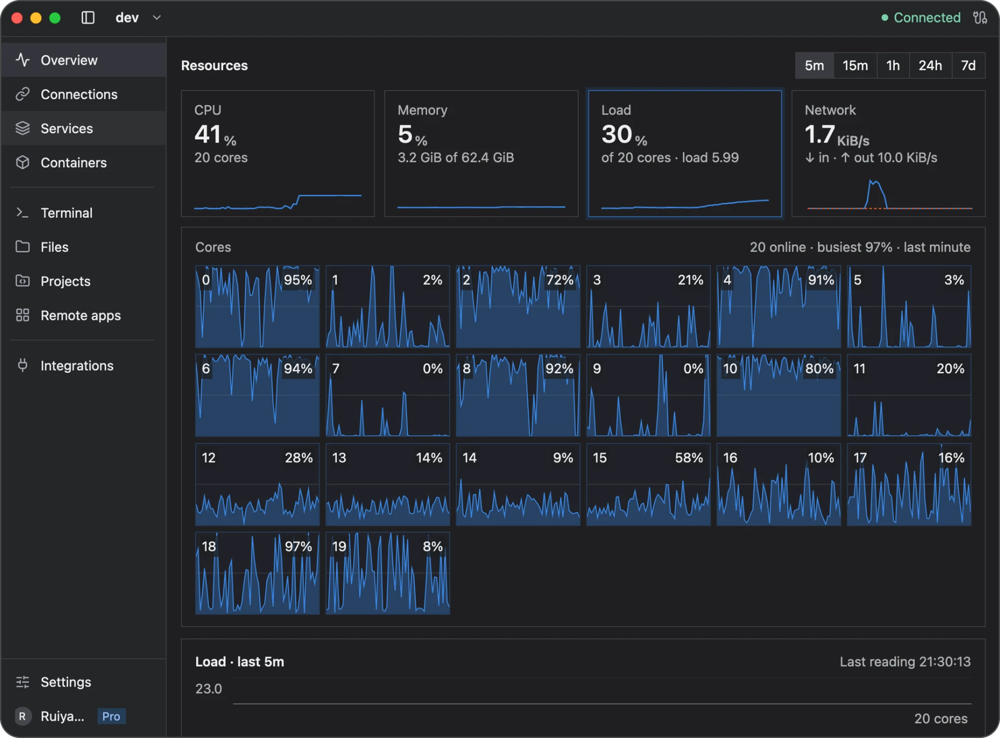

# Server monitoring

Open **Overview** to see how busy the selected server is: CPU, memory, load, network, storage and the busiest processes.

## Read the overview

- **CPU**, **Memory**, **Load** and **Network** show the latest reading. Choose one to graph its history. Hold the pointer over **Memory** for swap, or over **Load** for the 1, 5 and 15 minute averages.
- **Load** counts tasks running or waiting for CPU or disk, as a share of the cores. High load can explain a slow server even when CPU use is low.
- **Cores** shows each core over the last minute.
- **Storage** shows how full each filesystem is.
- **Processes** lists the busiest and largest processes. Use **Find a process** to filter them.

## Look back in time

Choose **5m**, **15m**, **1h**, **24h** or **7d** at the top right.

Newport records readings while it is connected to the server and keeps them on your computer for seven days. Beyond 24 hours it keeps one summary per minute, so short spikes show less in long ranges. A gap means Newport wasn't connected, not that use was zero.

## Clear the history

Open **Settings** and, under **Cache**, choose **Clear cache**. This deletes the history for all servers; your servers and preferences stay.

## Troubleshooting

| Symptom | Fix |
| --- | --- |
| The page says **Showing the last reading.** | The connection dropped. The page updates again when Newport reconnects. |
| Long ranges are empty for a new server | History starts when you first connect. Choose a shorter range. |
| A card shows **—** or says a value is unavailable | The server didn't report it. It isn't zero. |

For one app's activity, read its logs in [Services](services.md) or [Containers](containers.md).

[Back to the user guide](README.md)
