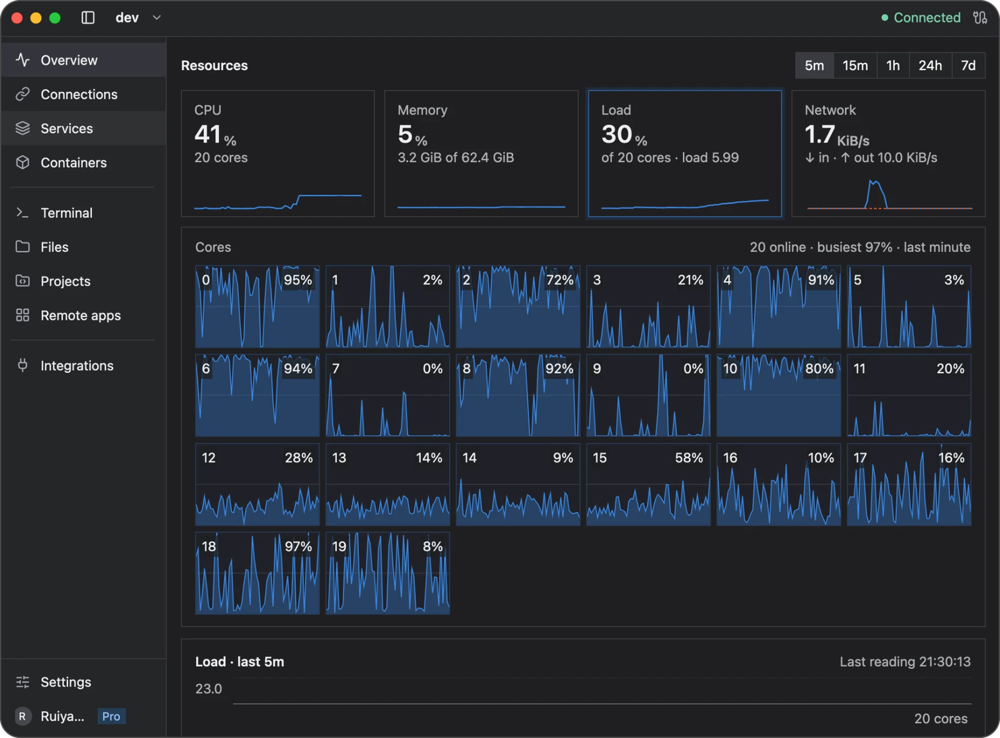

# Server monitoring

Open **Overview** to see the selected Linux server's resource usage. Monitoring uses Needle, so install the helper from **Integrations** if Newport asks for it.

## Read the overview

The page shows CPU, memory, load, network activity, storage, and process information. Use it to answer questions such as whether a busy application is consuming CPU, memory is running low, or a filesystem is filling up.

Load measures demand from tasks running or waiting for CPU or disk access. Newport also shows it relative to the number of CPU cores; sustained high load can help explain a slow server even when CPU usage alone is modest.

The values describe the server, not your own computer. Some process details may be unavailable when your SSH account cannot read them.

Choose a resource card to inspect it, and use the `5m` through `7d` controls at the top right to change the history range.

## Compare current activity with history

Choose a history range from five minutes to seven days. Longer ranges use summarized readings, so brief spikes may be less visible than in a short range.

History is stored on your computer. Newport keeps detailed readings for the latest 24 hours and one-minute summaries for the remainder of the seven-day retention period. It cannot record new readings while disconnected from the server; gaps are not evidence that resource usage was zero.

For application-specific details, open [Services](services.md) or [Containers](containers.md) and inspect the relevant logs and status.

## Clear recorded history

Open **Settings → Cache** and choose **Clear cache**. This clears metric history for all servers while keeping saved connections, passwords, and preferences. Sampling continues afterward.

## If data is missing

Check the server connection and Needle's status in **Integrations**. A newly added server needs time to accumulate history. If a particular reading is unavailable, check the error and the remote account's permissions instead of treating the missing value as zero.

See [Storage and recovery](storage.md) for retention and data protection.

[Back to the user guide](README.md)
