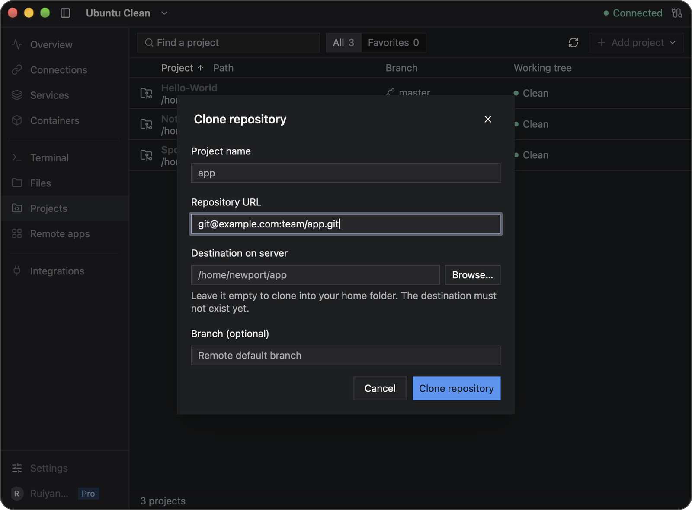
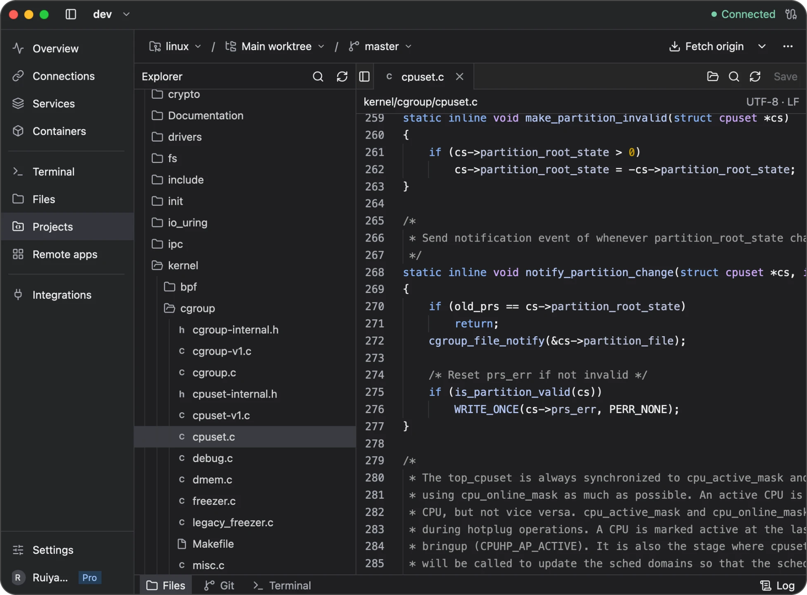
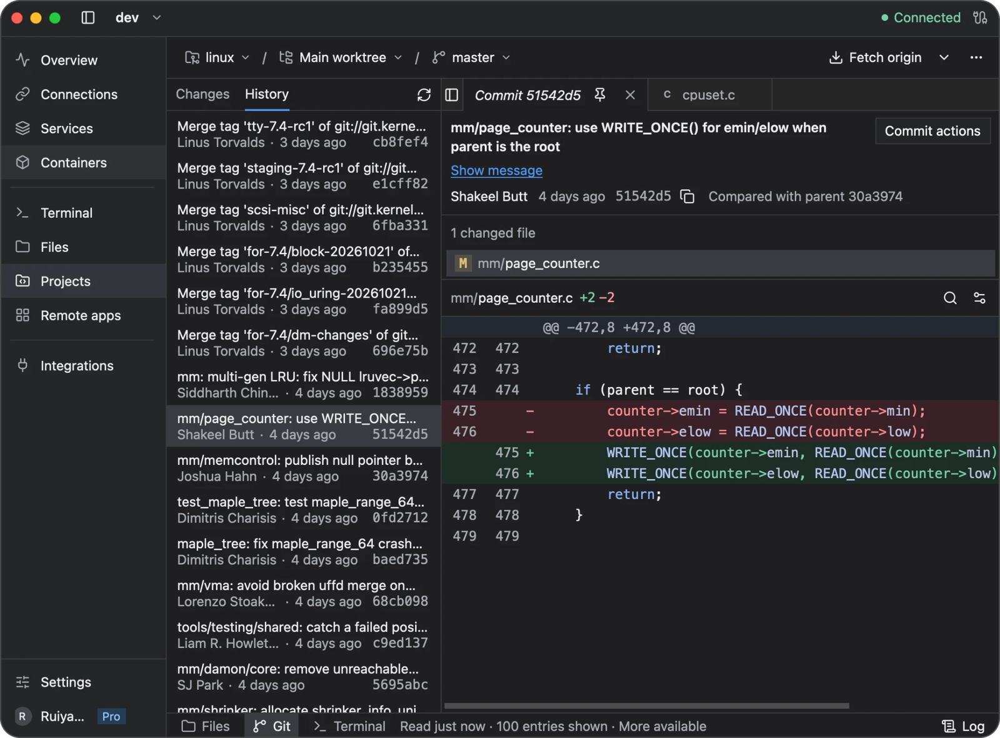

# Projects and Git

Use **Projects** to work with repositories on your Linux server. Your checkout, Git operations, and saved source files stay on the server; Newport provides the editor and review interface on your computer.

Needle must be installed for project and Git features. Your SSH account needs access to the repository and permission for any changes you make.

## Add a project

Select the server and open **Projects**. An empty library offers **Add a repository**, **Clone a repository**, and **Create a repository** directly. Once you have projects, use **Add project** for the equivalent choices:

| Choice | Use it when |
| --- | --- |
| **Add existing repository…** | The repository is already on the server; enter or browse to its absolute path |
| **Clone repository…** | You want to copy a Git repository into a directory on the server |
| **New repository…** | You want to start a repository in a new folder, or in an existing one whose files are kept |

Newport names the project after its folder or repository unless you type a name. Open it from the library; right-click a project for more actions. Favorites and filtering help when you have several repositories.

For a clone, paste the repository's SSH or HTTPS URL, such as `git@example.com:team/app.git`. Newport suggests a destination in your home folder on the server named after the repository, such as `/home/alex/app`; leave it empty to use it, or enter another path. The parent directory must already exist, and the destination folder must not exist yet.

For a new repository, leave **Folder on server** empty to create a folder named after the project in your home folder, or enter a path. Newport creates the folder if its parent exists.



**Destination on server** is a Linux path. It is not a folder on your Mac or Windows computer.

### Access a private repository

Git runs on the Linux server. Your browser sign-in on your computer and the local SSH agent used to connect Newport to that server do not automatically give Git access to a private repository.

Configure Git authentication for the **remote SSH account**: use the server's SSH agent/key configuration for an SSH repository URL, or its credential helper for HTTPS. Follow your Git host's setup instructions for that server account. Do not put passwords or tokens in the repository URL. Newport's Git operations cannot open an interactive password prompt.

Before cloning in Newport, open its **Terminal** and test access with your real repository URL:

```sh
git ls-remote git@example.com:team/app.git
```

A nonempty repository should return commit IDs and reference names without asking for credentials. Resolve any authentication or host-trust prompt on the server before retrying in Projects.

Removing a project with **Remove from list** removes its saved bookmark. The repository and its files stay on the server.

## Edit and save files



1. Open the project's file tree and select a file, or use **File → Open file…** to find it.
2. Edit the file in its tab. The editor marks changed content as **Unsaved**.
3. Choose **Save** in the file header or **File → Save file** to write it back to the server.
4. Open **Changes** to review the saved changes in Git.

Saving a file does not commit it. Committing does not push it to a Git remote. These are separate steps.

The editor supports up to 20 open tabs, 16 MiB per editable file, and 64 MiB of open file content per worktree. Some large files open as read-only sections; search then applies to the displayed section. Use **Previous** and **Next** to move through sections, or download the file from **Files**.

For completion, diagnostics, formatting, and symbol rename, see [Language tools](language-servers.md).

### Handle a file changed elsewhere

If another application changes a file on the server, Newport preserves your unsaved edits and offers ways to resolve the difference:

- **Review remote** shows the server's version without changing your edits.
- **Merge changes** tries to combine edits that do not conflict.
- **Use my edits**, available while reviewing the remote version, lets you confirm keeping your version over the reviewed remote version.
- **Reload remote** replaces your buffer with the server's content, discarding your unsaved edits after confirmation.

Review the result and save it. If **Merge changes** cannot combine overlapping changes, it leaves your edits intact and shows an error. Copy your edits somewhere safe, compare them with **Review remote**, and combine the versions manually. **Use my edits** confirms the version you reviewed; the next save writes your buffer over it. A newer server change will require another review.

If the server connection changes, open buffers are kept but saving may be disabled. Copy the text from each unsaved tab into a local text editor and save those copies on your computer before quitting. Restore the intended connection, compare the server files, then save your intended changes in Newport. Unsaved buffers are not restored after quitting.

## Review and commit changes

Open **Changes** to inspect file diffs. Stage the changes you want in the next commit, unstage anything that should stay out, enter a commit message, and commit.

If a commit reports a missing author, configure a name and email for this repository. In Newport's Terminal, replace the path and identity below with yours:

```sh
git -C /home/alex/projects/app config user.name "Alex Example"
git -C /home/alex/projects/app config user.email "alex@example.com"
```

These identify the author in commits; they do not sign you in to a Git host. Retry the commit afterward.



Use **History** to inspect earlier commits and their file diffs. Review destructive actions such as discarding changes or resetting a branch carefully: they can remove work from the remote checkout.

## Sync with a Git remote

Use **Fetch**, **Pull**, or **Push** for the selected remote and branch:

- **Fetch** updates your view of the remote repository.
- **Pull** brings remote changes into your current branch and may require conflict resolution.
- **Push** sends commits in your server checkout to the Git remote.

Check the selected destination before syncing. The **Remotes** view lets you manage repository remotes. A successful SSH connection to the server does not by itself grant access to a private Git repository; follow [Access a private repository](#access-a-private-repository) to configure Git authentication on the server.

## Branches, worktrees, tags, and stashes

Switch branches from the project's branch controls. A worktree is another checkout of the same repository in a separate directory, useful for working on two branches at once. Create and manage worktrees from the project controls, and check the active worktree before editing or committing.

Use **Stashes** to inspect saved uncommitted changes and **Tags** to inspect or manage named revisions. Read confirmation dialogs before removing a worktree, dropping a stash, or deleting a tag.

## Troubleshooting

If a repository does not open, check its absolute remote path, your account's permissions, and Needle's status in **Integrations**. If a Git operation fails, read its error before retrying; permission problems, conflicts, and an unavailable Git remote need different fixes.

For an editor conflict, follow the review steps above. For a missing language server, use the [language-tools guide](language-servers.md#when-a-tool-cannot-finish).

[Back to the user guide](README.md)
