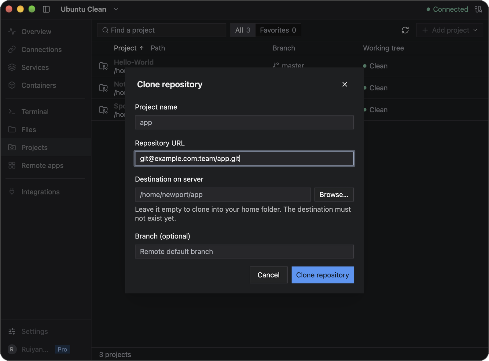
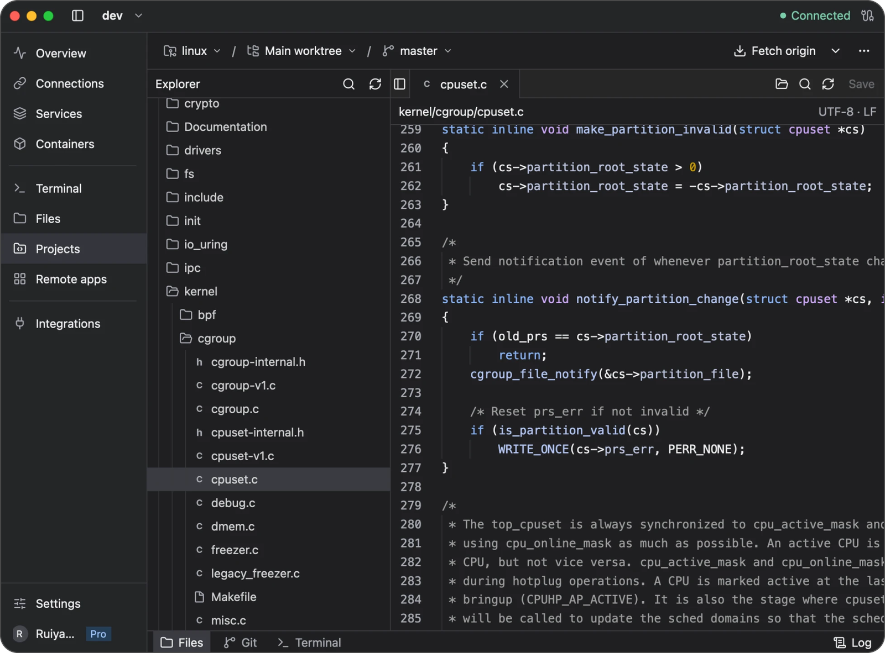
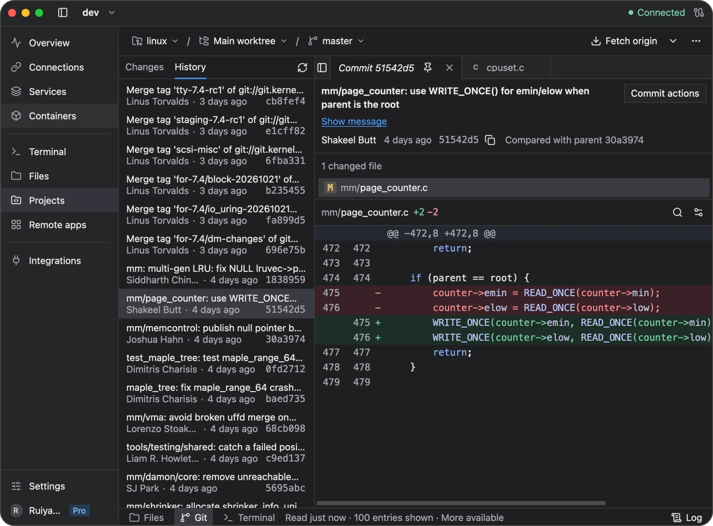

# Projects and Git

Open **Projects** to work with Git repositories on your Linux server. Edit files, commit changes and sync with a Git remote. The repository and Git run on the server, under your SSH account.

## Add a project

Select the server and open **Projects**. Choose **Add project**, or a card in an empty list:

- **Add existing repository…** (**Add a repository**): enter or **Browse…** to the repository's folder on the server.
- **Clone repository…** (**Clone a repository**): enter its **Repository URL**, such as `git@example.com:team/app.git`.
- **New repository…** (**Create a repository**): start a repository in a new folder, or in an existing one, which keeps its files.



**Destination on server** and **Folder on server** are paths on the server. Leave them empty for a folder in your home folder, named after the repository for **Clone repository…** and after the project for **New repository…**. A clone's destination must not exist yet.

You can also open a folder from **Files** with **Open as project**.

Right-click a project for **Rename…**, **Open in Files** and **Remove from list…**, which forgets the project but leaves the repository on the server.

### Access a private repository

Git uses the server account's credentials, not your computer's. Set up an SSH key or a Git credential helper for that account, as your Git host describes. Newport can't answer password prompts. Don't put passwords or tokens in the URL.

To test, run this in the server's **Terminal**:

```sh
git ls-remote git@example.com:team/app.git
```

It should list commits without asking anything. Answer any host key question there.

## Edit and save files



1. Open the project. Choose **Files** at the bottom left for the file tree, or press **Cmd+P** (**Ctrl+P** on Windows) to find a file by name.
2. Edit the file. Its header shows **Unsaved**.
3. Choose **Save**, or press **Cmd+S** (**Ctrl+S**), to write it to the server.

Saving doesn't commit, and committing doesn't push. Newport asks before you quit with unsaved edits.

Drag a file tab, or choose **Workspace** > **Move tab left** or **Move tab right**, to move it. Your file tabs open again, in the same order, the next time you open the project; each file is read when you first show its tab.

You can keep 20 tabs in each worktree. Opening another file automatically closes the first unchanged tab in tab order. Tabs with unsaved edits, a save or reload in progress, or an unresolved remote conflict stay open. If every tab needs to stay open, save or close one before opening another file. You can edit files up to 16 MiB. Larger files, and files with very long lines, open read-only in sections, with **Previous** and **Next**.

For completion, error marks and refactoring, see [Language tools](language-servers.md).

### Handle a file changed elsewhere

If the file changes on the server while you have unsaved edits, Newport keeps your edits and shows **Changed remotely · your edits are kept**:

- **Review remote** shows the server's version, read-only. **Back to my edits** returns.
- **Merge changes** combines the two when they don't overlap. If they do, your edits stay and Newport says so.
- **Use my edits**, while you review, lets your next save replace that version.
- **Reload remote** discards your edits and loads the server's version, after asking.

If the server connection changes, saving is turned off. Copy unsaved text somewhere safe before you quit.

## Run commands in the project

Choose **Terminal** at the bottom of the project for a shell in the project's folder. These terminals end when you close them or the project, or quit Newport. For shells that keep running, use the server's **Terminal** page; see [Terminals](terminal.md).

## Review and commit changes

Choose **Git** at the bottom left, then **Changes**.

1. Select a file to see its diff.
2. Choose **Stage** for the changes to commit, or **Unstage** to leave them out.
3. Enter a summary, and a description if you like.
4. Choose the commit button, such as **Commit 2 files to main**.

**Discard file changes…** removes changes from the file on the server. There is no undo.

If a commit says the author identity is missing, choose **Repository settings…** and enter the **Name** and **Email** for commits in this repository.

**History** lists commits. Select one to see its files and diffs, and choose **Commit actions** to revert, cherry-pick, reset to it and more.



### Resolve conflicts

After a merge, rebase or cherry-pick that conflicts, the files appear under **Conflicts**. Edit a file and choose **Stage resolution**, or pick **Ours**, **Theirs** or **Base** and choose **Use selected side…**. You can commit when no conflicts remain.

## Sync with a Git remote

The button at the top right shows the next step for your branch, such as **Fetch origin**, **Pull origin** or **Push origin**, with the number of commits to pull or push. Its arrow has **Fetch upstream**, **Pull upstream**, **Push upstream** and **Manage remotes**.

- **Fetch** gets the remote's new commits without changing your files.
- **Pull** fast-forwards your branch. If both sides have new commits, it stops; merge or rebase from the branch menu instead.
- **Push** sends your commits without overwriting history on the remote.

**Remotes** has **Fetch**, **Pull…** and **Push…** for other remotes and branches. Its **Branches and tags…** also has **Push with lease…**, which can overwrite a remote branch's history after you confirm **Replace remote branch**.

## Branches, worktrees, tags and stashes

The bar at the top shows the project, worktree and branch. Click each to switch or create one, for example with **New branch…** or **New worktree…**. A worktree is a second checkout of the same repository in another folder, for working on two branches at once.

**…** at the top right opens **Stashes**, **Tags** and **Remotes**. Read the confirmation before you delete a branch, tag or stash, or remove a worktree.

## Troubleshooting

| Symptom | Fix |
| --- | --- |
| A repository doesn't open | Check its path and that your account can read it. |
| Clone, fetch or push fails with an authentication error | Set up Git access for the server account. See [Access a private repository](#access-a-private-repository). |
| "All 20 tabs have unsaved changes or pending work" | Save or close a tab, or let its pending operation finish, then open the file again. |
| A language server is missing | See [Language tools](language-servers.md#when-a-tool-cannot-finish). |

[Back to the user guide](README.md)
