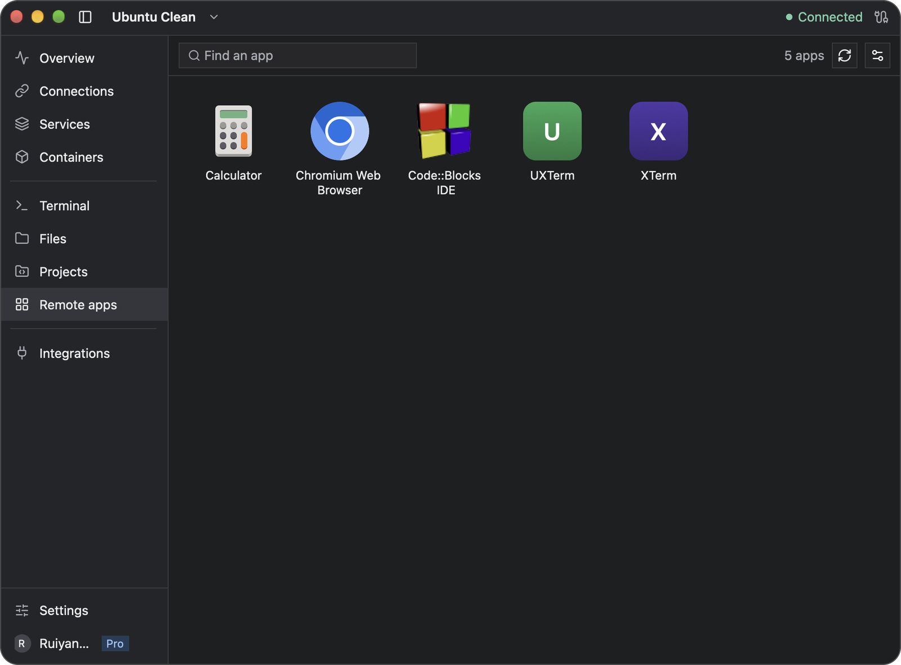
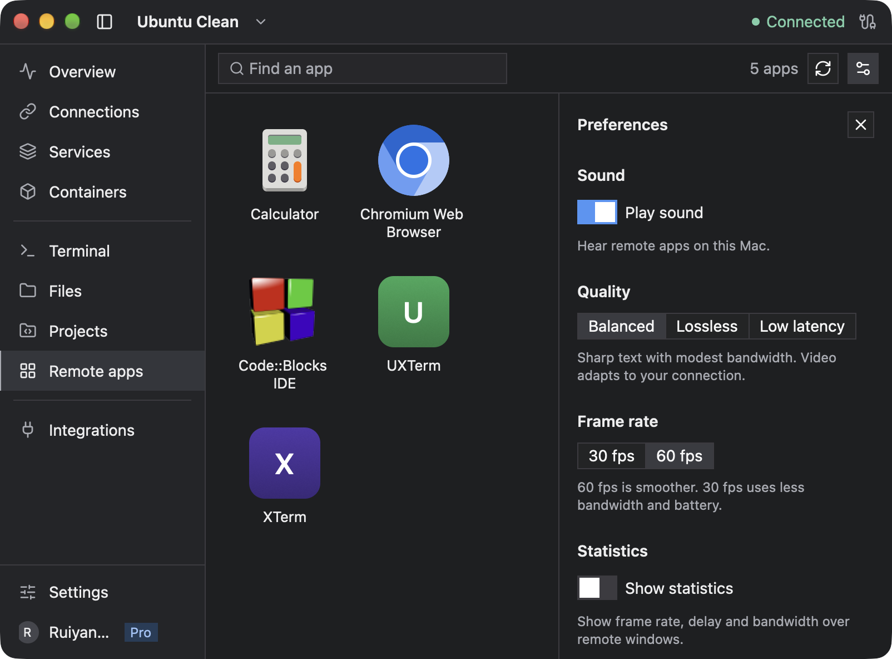

# Remote apps

Remote apps runs Linux graphical apps on your server and shows their windows on your computer. Open an app from the **Remote apps** list, or run it in a Newport terminal. The apps keep running on the server, and they show on the computer you are using.

## Before you start

- Newport on a Mac with Apple silicon, or on Windows.
- A Linux server with an x86_64 or ARM64 processor.
- A free trial or Newport Pro on this computer. Signing in alone isn't enough.
- Installing missing software on the server may need administrator rights.

## Set up a server

1. Select the server and open **Remote apps**.
2. If the page asks, choose **Sign in**, then **Start free trial**, or the button it shows, such as **Use Pro on this computer**.
3. Choose **Get started**. Newport checks what the server needs.
4. For each missing item, choose **Install**, or follow the steps shown. **Install** runs the command in a terminal; type `exit` when it finishes. Then choose **Check again**. Optional items can wait.
5. Choose **Activate**. Newport installs Newport Remote on the server and lists the server's apps.



Use **Find an app** to search, and the circular-arrow button (**Refresh**) after you install an app on the server.

If the page offers **Update**, choose it to update Newport Remote on the server. Open apps keep running.

## Open an app

Click an app in the list. Its window opens on your computer. If the app is already running, clicking it brings its windows to your computer instead of opening it again. Right-click an app for its own actions, such as a private window, and while it runs, for **New window** and **Quit**.

On a Mac, with **Open as separate apps** on, choose **Options** > **Keep in Dock** on an app's Dock icon to keep it there. Clicking it opens the app, even when Newport isn't running: Newport starts in the background and opens it. Newport keeps the Dock icon's name and picture up to date as the server's apps change, and removes the app when you remove the server.

File choosers and other dialogs stay above the window that opened them. A file chooser browses files on the Linux server.

You can also run any graphical program in a Newport terminal on the server, including programs that aren't in the list:

```sh
gnome-calculator
```

A terminal can open apps only if it was opened on a computer with Remote apps set up for the server and a trial or Pro. If an older terminal can't, open a new tab. **Remote apps** can't quit an app you started from a terminal; quit it in its own window.

Apps that need X11, or have parts that do, need XWayland 23.1 or newer on the server. Setup offers to install it, and an app that needs it says so.

## Move apps between computers

Each server account has one set of running apps, shared by every computer that connects with that account. They show on one computer at a time, and each computer that shows them needs its own trial or Pro.

The apps move to this computer, with all their windows, when you:

- type, paste or click in one of the server's terminals here;
- open a new terminal tab for the server here;
- open an app from **Remote apps**;
- choose **Show here**.

Selecting a tab or window, reconnecting and starting Newport don't move them. Windows that move because you typed in a terminal don't take the keyboard, so your typing stays in the terminal.

When another computer shows the apps, their windows close here and **Remote apps** says **Shown on** and that computer's name. Choose **Show here** to bring every window back. If two people use the same server account on different computers, the apps move to whoever last used a terminal or opened an app.

## Keep apps running

- When the connection drops, the windows close here and the apps keep running. After Newport reconnects, type in one of the server's terminals or open an app to show them again.
- Quitting Newport leaves every app running on the server. When you come back, type in one of the server's terminals or open an app to show them again.
- Restarting the server ends every app.

## Copy, paste and open links

What you copy in a Linux app can be pasted on your computer. To paste from your computer into a Linux app, turn on **Clipboard access** for the server in **Integrations**. Links that apps open go to your computer's browser when **Browser links** is on. See [Clipboard and browser sharing](clipboard.md).

## Scroll in an app

On a Mac, trackpad scrolling follows your Mac's direction and momentum. Some Linux apps scroll in wheel steps, so the same gesture can feel different between apps. Mouse wheels use the Linux app's usual scrolling steps.

## Change sound and quality

Choose the sliders button (**Preferences**) at the top right of **Remote apps**.

- **Play sound** plays sound from the apps, and from programs you run in a terminal, on this computer.
- **Quality**: start with **Balanced**. Choose **Low latency** for responsiveness, or **Lossless** for exact pixels.
- **Frame rate**: **60 fps** is smoother; **30 fps** uses less bandwidth and battery.
- **Show statistics** shows frame rate, delay and bandwidth over the apps' windows.
- **Open as separate apps** is on by default. On a Mac, each app gets its own Dock icon, menu bar and Cmd-Tab entry; on Windows, its own taskbar button and icon, which you can pin or add to the Start menu. When it can't, the apps open in Newport windows and the setting says why. Changing it moves apps that are already open.

Other changes apply the next time this computer starts showing the server's apps.



## Troubleshooting

| Symptom | Fix |
| --- | --- |
| **Remote apps** is missing from the sidebar | Use the current download from [newport.app](https://newport.app/#download), on a Mac with Apple silicon or on Windows. If it is still missing, [report your version](troubleshooting.md#report-a-problem). |
| An app says it needs X11 | Choose **Install** to add XWayland, then open the app again. |
| The page says the server has a newer Newport Remote | Update Newport on this computer. |
| An app isn't in the list | Install it on the server and choose **Refresh**, or run it from a terminal. |
| A program run in a terminal can't open a display | Run it again in a new terminal tab. If that fails, open **Remote apps** for the server and finish setup. |
| Needle reports that the account has no runtime directory | Check that the server's login session provides an absolute `XDG_RUNTIME_DIR` with private permissions, then open a new terminal tab. |
| Chromium reports `snap.chromium/newport-display/wayland-0: No such file or directory` | In that terminal on the server, run `WAYLAND_DISPLAY="$XDG_RUNTIME_DIR/newport-display/wayland-0" chromium`. This gives Chromium the full display socket path for that launch. |
| The windows disappeared | If the page says **Shown on**, choose **Show here**. Otherwise type in one of the server's terminals. |
| An app is running without a window | It may be in the system tray, which Remote apps can't show. Choose **Quit** to end it. |

[Back to the user guide](README.md)
