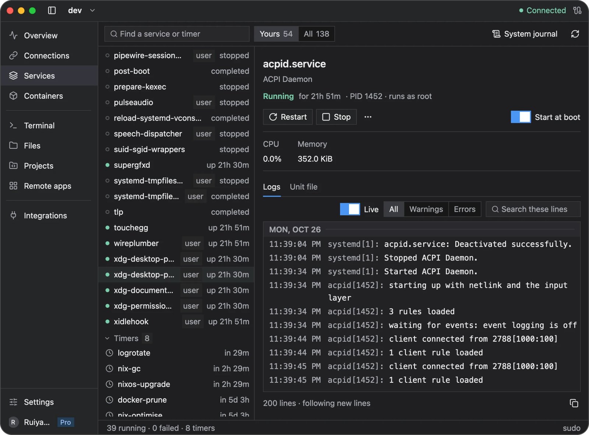

# Services

Open **Services** to see the systemd services and timers on the selected server, read their logs, and start, stop or restart them. The server must use systemd.

## Find a service

Type in **Find a service or timer**, or browse the list, and select a service to see its state and logs.

**Problems** lists services that failed or keep restarting. **Services** lists your own, including user services, and **Timers** shows when scheduled jobs run next. **Yours** folds the operating system's services into one row; **All** lists them.

## Read logs

The **Logs** tab has **Live** to follow new lines, **All**, **Warnings** and **Errors** to filter, and **Search these lines**. **Unit file** shows the service or timer configuration in a read-only editor directly below its tabs and any available file path. Scroll inside it to read longer files. Journal errors wrap within the pane, with **Try again** beside the message. **System journal**, at the top right, shows logs from the whole server.

## Start, stop or restart a service

Use **Start** or **Restart**, and **Stop**. **…** has **Reload configuration** when the service supports it. **Stop** asks first, because anything relying on the service stops working.

**Start at boot** sets whether the service starts when the server boots. Turning it off asks first, and doesn't stop the service now.

## Enter your sudo password

The access shown at the bottom right says what you can change. Your user services always change directly.

If sudo needs your password, an action shows **This needs your sudo password. Run this command in the Terminal.** Choose **Open in Terminal**. A **Service command** tab opens with the command typed in but not run. Check it, press **Return**, and enter your password.

## Troubleshooting

| Symptom | Fix |
| --- | --- |
| **Services aren't available here** | Check that the server uses systemd, then choose **Try again**. |
| The bottom bar says **no user services** | Newport can't reach your systemd user session. Hold the pointer over it for the reason. |
| Logs say the account can't read the journal | Ask the server's administrator to add you to the `systemd-journal` or `adm` group. |
| A button is unavailable | Your account can't change that service. Hold the pointer over the access at the bottom right. |
| A service fails again after a restart | Read its **Logs** and **Unit file** to find the cause. |

For apps in containers, see [Containers and Compose](containers.md).

[Back to the user guide](README.md)
