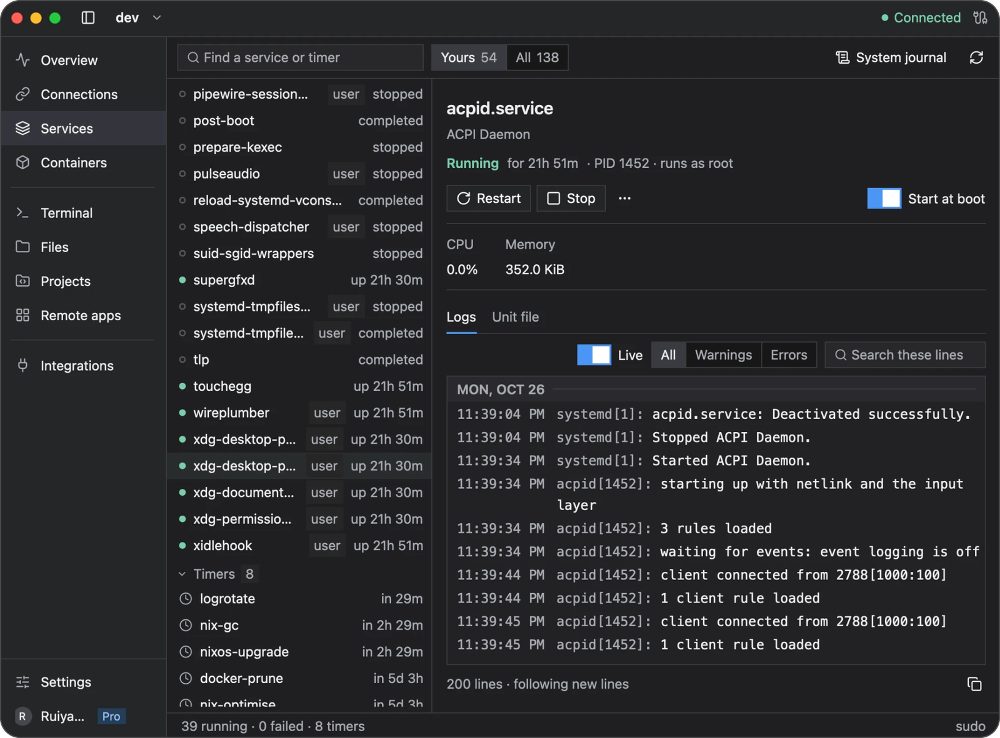

# Services

Use **Services** to inspect and manage systemd services on your Linux server. Needle must be installed, and the server must use systemd. What you can view or change depends on your SSH account's permissions.

systemd is the service manager used by many Linux distributions. A **unit** is its configuration for a service or another managed resource. The **journal** collects logs from those services and the operating system.

## Find a service

1. Select the server and open **Services**.
2. Find the service you want and inspect its state. Failed services are highlighted so you can investigate them.
3. Open it to see its details, unit configuration, and logs.

System services and user services are separate. A user-service list requires a working systemd user session for the SSH account; not every server provides one.

Select a service on the left to see its state and logs on the right. **Yours** narrows the list; **All** includes system services. Timers appear below services and represent scheduled systemd work.

## Read logs

Open a service's logs to follow its output and search for a message. Use **System journal** when you need a broader view of server events.

If logs are unavailable or incomplete, check your account's journal permissions. An empty log view does not necessarily mean the service has never written logs.

## Start, stop, or restart

Choose **Start**, **Stop**, or **Restart** from the service details and review any confirmation. These actions change the actual service on the server and may interrupt applications using it.

If an action needs an interactive password, Newport can offer **Open in Terminal**. Review the command and complete authentication there. Refresh the service status afterward if needed.

Where available, **Start at boot** controls whether a service starts automatically. A service's current running state and its startup setting are separate: starting it now does not necessarily enable it at boot.

## Troubleshooting

| Problem | What to check |
| --- | --- |
| Services is unavailable | Confirm that the server uses systemd and that Needle is installed |
| User services are missing | Check whether the SSH account has an active systemd user session |
| An action is denied | Check account permissions or use the offered terminal command for authentication |
| A service fails again after restarting | Read its logs and unit configuration to find the underlying problem |
| Status looks out of date | Refresh after checking that the SSH connection is available |

For containerized applications, use [Containers and Compose](containers.md).

[Back to the user guide](README.md)
