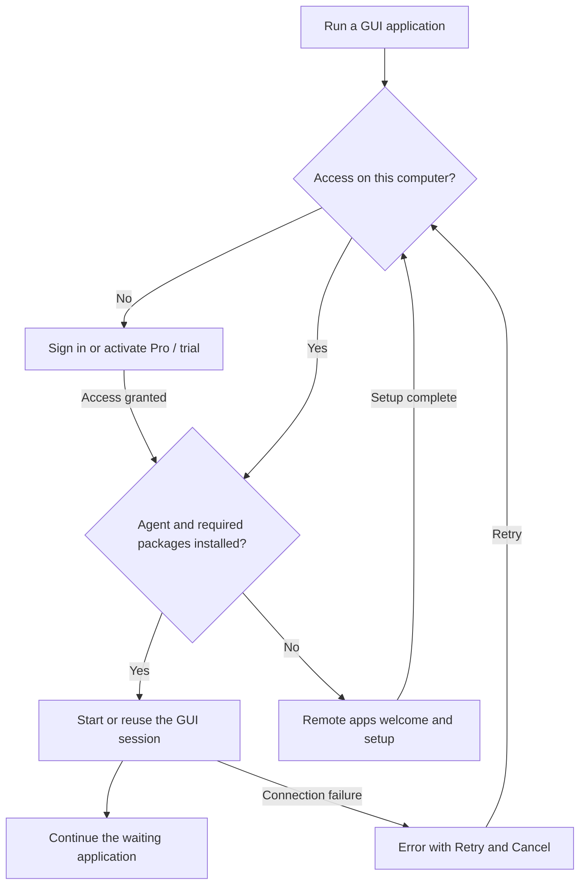

# GUI applications launched from the terminal

## User flow

Opening an SSH terminal is immediate and never opens GUI onboarding. A GUI
application launch, such as `chromium`, owns the following flow:

An active trial or usable Pro seat grants access. Signing in alone does not.
Account loading must not flash a sign-in modal. Once access is granted, the
account modal closes automatically; there is no intermediate “license ready”
screen. Starting an installed agent is silent. Missing or incompatible agent
software, or missing required packages, leads to setup. A network, SSH, or
display startup failure offers Retry instead of sending the user through
installation again.

## Continuing a launch

A launch belongs to its original saved server and terminal session. Waiting for
login or setup must preserve the program's arguments, working directory,
environment and terminal input/output. It must not restart the shell, insert
text into it, or replay a compound shell command. Concurrent requests are
bounded and queued; changing the selected server does not redirect a launch.

Cancel, Ctrl+C, closing the terminal, disconnecting the integration, or deleting
the server abandons the waiting launch. Late account or setup results must not
start it. Transient failures leave a live launch waiting for Retry. A request
whose process has already exited cannot be automatically replayed; the user
runs it again explicitly.

After setup, return to the originating terminal when it still exists. Clipboard
and browser sharing keep their existing independent permission settings.

## Launch handoff

Needle exposes a private, bounded local launch broker. In Newport terminal
sessions, command shims discovered from non-terminal desktop entries wait at
this broker before executing the original program. The waiting process retains
its own arguments and working directory; those are not transmitted to the UI.
The broker sends only a request identity, terminal identity and application
label. An authorized GUI session returns a validated display environment. The
same waiting process then executes the original program exactly once.

The shims live in Newport's private cache and are added only to Newport terminal
PATH. They do not replace system executables. Explicit absolute paths and
applications without desktop entries may bypass the handoff; the existing
display-request notice remains their fallback and cannot resume an already
failed process. Non-GUI invocations such as version/help and headless execution
pass through without account onboarding. For a program without a desktop entry,
use `newport-agent gui --program /absolute/path/to/app -- [arguments]` to request
the same handoff explicitly. New shell sessions pick up newly installed apps.
In an existing Bash or Zsh session, `eval "$(newport-agent env)"` refreshes the
launchers and clears cached command paths so newly installed apps use them.

The shell's GUI command PATH is prepared independently of transport startup.
A launch allows up to 10 seconds for the integration connection to become ready,
and up to 15 minutes for account/setup guidance. Expired requests must be run
again explicitly.

## Verification

- Opening a terminal does not prepare a GUI session or show a modal.
- Licensed, installed launches start directly; simultaneous terminals keep their identity.
- Successful sign-in automatically checks setup and continues a waiting launch.
- Missing agent/dependencies opens setup; completion returns to the originating terminal.
- Startup errors offer Retry and Cancel; retries do not duplicate execution.
- Cancellation and stale replies never execute a program.
- Argument boundaries, working directory, exit status, browser and clipboard behavior survive the handoff.

Automated coverage lives in `terminal_setup.rs` (account/setup state transitions),
`tools/agent/tests/gui_launch.rs` (real waiting processes, argument preservation,
cancellation and late replies), and the terminal/backend regression suites.

On the Parallels Ubuntu test VM, the licensed profile opened the Chromium Snap
from its terminal without Newport onboarding. The signed-out profile showed
sign-in guidance only after `chromium` and returned to the original shell on
Cancel. The Flatpak fixture streamed with its required X11 toolkit overrides.
Login success and missing-software continuation are covered by scripted UI tests.
