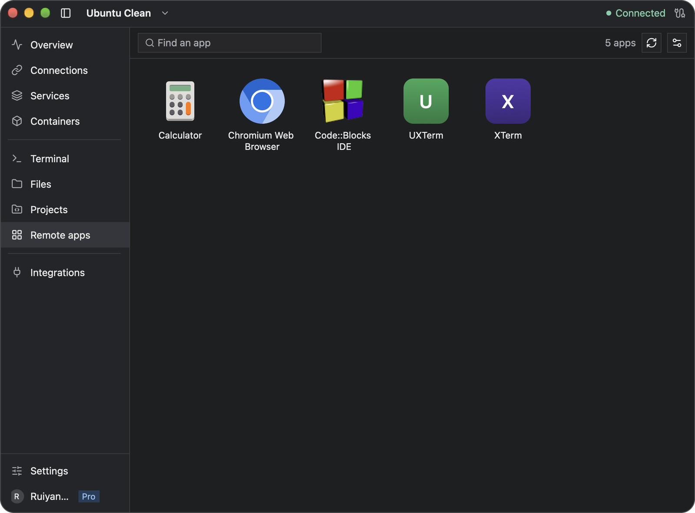
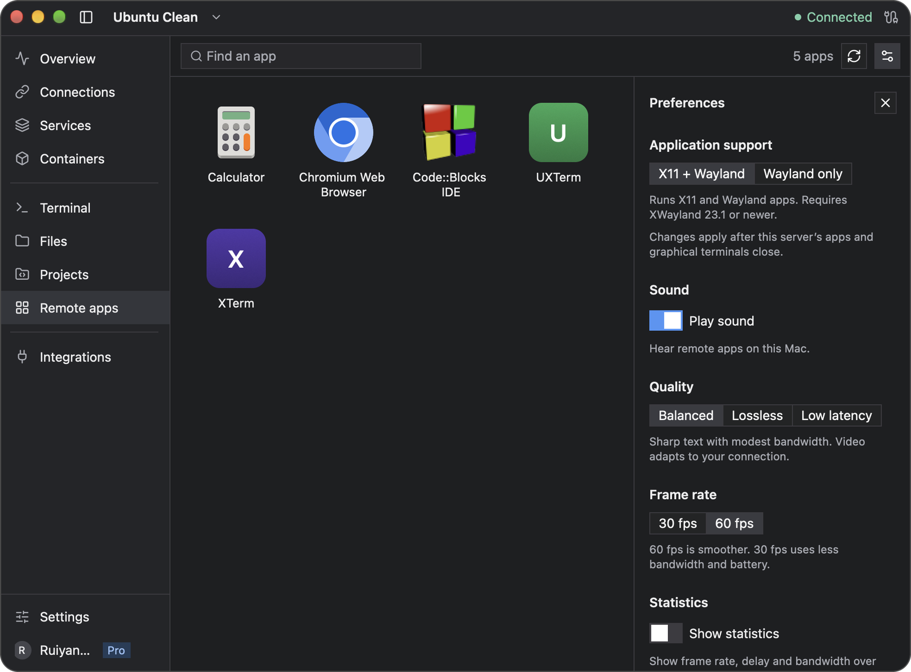

# Remote apps

Remote apps lets Linux graphical applications run on your server and appear in windows on your computer. You can launch them from **Remote apps** or from a Newport terminal once the server is set up.

Remote apps is available on macOS with Apple silicon; Windows does not currently support it. Use the macOS download from [newport.app](https://newport.app/#download). Launching requires an active trial or Pro access on this computer. Signing in by itself does not activate access. Other SSH workspaces remain available without setting up graphical applications.

## Set up a server

1. Select your Linux server and open **Remote apps**.
2. Follow the account prompt if access is needed. You can also open your account from the sign-in or account button at the bottom of the sidebar. Start an available trial or activate Pro on this computer.
3. Follow the server checks to install or update Needle and any required packages.
4. Choose **Application support**, then finish setup.
5. Select an installed application to launch it. If you have just installed an app on the server, refresh the list.

Package installation may need administrative permissions on the server. The setup screen shows missing dependencies and available installation actions.



After setup, the list shows applications installed on this server. Use the circular-arrow button to refresh it and the sliders button to open Preferences.

### Choose application support

| Mode | Use it for | Requirement |
| --- | --- | --- |
| **X11 + Wayland** | The widest range of supported Linux apps; this is the default | XWayland 23.1 or newer on the server |
| **Wayland only** | Apps that can run with native Wayland | Needle installed or updated through Remote apps setup; XWayland is not required |

X11-only applications cannot run in Wayland-only mode. The selection applies to both Remote apps and graphical applications launched from terminals.

After changing the mode, close that server's remote-app windows, and the terminals you launched graphical apps from, before launching again. Existing sessions keep their original mode until closed. Wait for the server check to finish before retrying.

### Adjust sound and display quality

After setup, open the sliders button at the top right of **Remote apps** to show **Preferences**. This is also where you can change **Application support** later.

- **Play sound** controls whether remote apps play audio on your computer.
- **Quality** offers Balanced, Lossless, and Low latency. Start with Balanced; try Low latency for responsiveness or Lossless when image fidelity matters more than bandwidth.
- **Frame rate** offers 30 or 60 fps. Lowering it reduces bandwidth and battery use.
- **Show statistics** displays frame rate, delay, and bandwidth over remote windows to help diagnose performance.

These preferences apply when a new graphical session starts. Close and relaunch that server's graphical apps, and open new terminals, to use the new settings.



Application support determines which Linux apps can launch; the controls below it adjust playback and connection quality.

## Launch from a terminal

Every Newport terminal on a set-up server can launch graphical applications. Run an installed application normally, for example:

```sh
chromium
```

The app opens in a window on your computer. Multiple apps can stay open together.

A terminal never waits for graphical apps. It opens as a normal shell right away and stays usable if the graphical session can't start or ends later.

- If the server's graphical session is already running, a new terminal joins it. Commands, scripts, and absolute executable paths can then use it directly.
- Otherwise, a recognized app launcher starts the graphical session when you run it.
- If account access or setup is still needed, the launcher waits and Newport shows what to do. The launch continues after you finish. **Cancel** or **Ctrl+C** abandons it, and the shell stays as it was.
- If the graphical session can't start, the command reports an error and your shell keeps running.

Opening a terminal alone never starts Remote apps setup.

For an application without a recognized launcher, request setup explicitly:

```sh
newport-agent gui --program /absolute/path/to/app -- [arguments]
```

Replace the path and optional arguments with your program. A direct executable path in a terminal that opened before the graphical session started may fail before Newport can help; run it in a new terminal instead.

Open a new terminal after installing an application. For an existing Bash or Zsh shell, you can refresh the available launchers with:

```sh
eval "$(newport-agent env)"
```

## Clipboard and browser behavior

Clipboard and Browser remain separate permissions in **Integrations**. Enable Clipboard if a remote application needs to read text or images copied on your computer.

`newport-agent open https://example.com` asks your local browser to open a link when Browser sharing is enabled. Running a browser such as `chromium` directly starts that browser on the server.

See [Clipboard and browser sharing](clipboard.md) for image paste and existing-shell setup.

## Close apps and reconnect

Save your work before closing an app or quitting Newport. Quitting closes open remote apps, and unsaved changes in them can be lost.

Normal shell job control applies to apps started from a terminal. A program may exit when its originating terminal closes. Use the shell's usual process-management tools when you need it to survive that terminal, but do not rely on them to preserve a lost graphical connection.

If the shared graphical connection is lost, existing applications cannot move to a replacement display. Retry the connection and relaunch affected applications. An established SSH shell can remain usable even when its graphical connection fails.

## Troubleshooting

| Problem | What to do |
| --- | --- |
| Remote apps is missing from the sidebar | On macOS with Apple silicon, update to the current download from [newport.app](https://newport.app/#download); if it remains missing, [report your version and OS](troubleshooting.md#report-a-problem). Remote apps is unavailable on Windows. |
| You are signed in but cannot launch apps | Check that this computer has an active trial or Pro access; follow the account prompt |
| A server dependency is missing | Install the package shown by setup, then run the check again |
| An X11 app fails in Wayland-only mode | Switch to **X11 + Wayland**, close existing graphical sessions, and relaunch |
| Launch fails after a connection interruption | Use **Retry**; rerun the command if its original process has already exited |
| An app is missing from the list | Install it on the server and refresh; use an explicit terminal launch if it has no desktop entry |
| A Snap or Flatpak app fails | Check the package's display and sandbox requirements; compatibility varies by application |
| A GUI app launched from a terminal reports an error | Open **Remote apps** for that server and follow its checks, then run the command again |

Long-running account or setup prompts can expire. If that happens, complete setup and run the application again.

[Back to the user guide](README.md)
